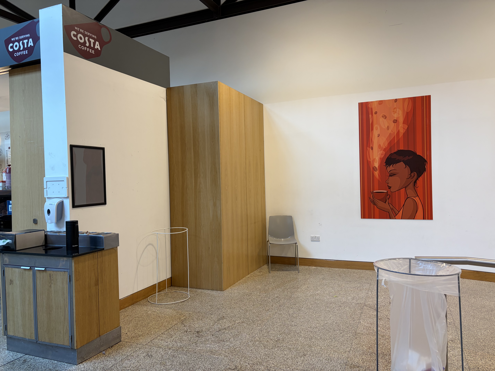
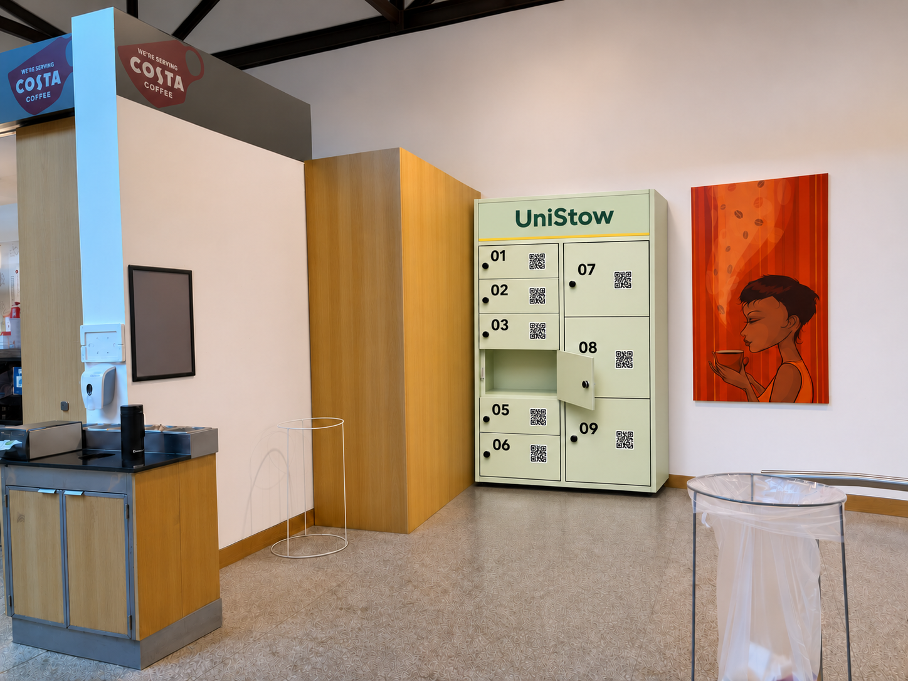
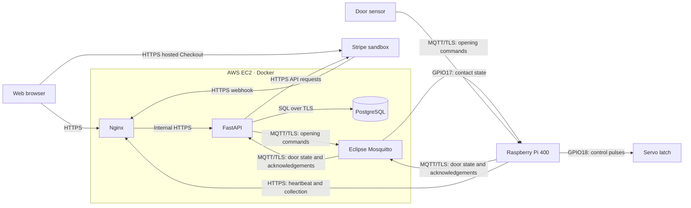

# UniStow

UniStow is a mobile-friendly campus locker prototype. Users register, reserve a locker,
pay through Stripe in test mode and open it from their account. A Raspberry Pi 400
controls the servo latch and reports the magnetic door sensor.

[Website](https://unistow.app) · [Source repository](https://github.com/nikitsya/UniStow)

## How it works

1. Sign in and choose Locker 4, the only physical locker. The other eight are placeholders.
2. Select 1–4 calendar days, accept the terms and reserve. One day costs EUR 1.
3. Continue to the rental page and select **Pay**. Confirmed payment enables access.
4. Use **Open locker** during the paid period. Your locker card shows **Continue rental**.
5. Select **Finish rental**, collect everything and close the door. The controller
   verifies closure and acknowledges completion before the locker becomes available.

Days end at **18:00, Europe/Dublin**. Before 18:00, the reservation date is day one;
at or after 18:00, the next date is day one. The deadline is calculated when reserving
and does not move when payment is confirmed. Prices and times are checked by the server.

Starting checkout requires more than 31 minutes before the booked deadline. From
17:29 until 18:00, the booking form offers 2–4 days and explains the restriction;
one-day bookings resume at 18:00. These times use Europe/Dublin. A reservation
made earlier can also run out of time to start payment; its page explains how to
cancel and choose another period. An already-created checkout keeps its own expiry.

An unpaid reservation is held for up to 15 minutes. Starting checkout keeps it blocked
until Stripe payment is reconciled; checkout has its own expiry. Rental status, door state
and availability update automatically while the page is visible. A closed door reading
does not prove that the latch is locked.

## Project images

The [initial prototype](docs/images/prototype/initial-prototype/) contains
fully AI-generated concept visualisations. The
[physical prototype](docs/images/prototype/physical-prototype/) contains edited
versions of the author's own photographs of the real UniStow prototype. AI
generated the university canteen backgrounds and retouched perspective, lighting,
lettering and small hardware details for presentation. The canteen setting is
illustrative.

- [Closed locker](docs/images/prototype/physical-prototype/unistow-prototype-closed-ai-background.png).
- [Open locker](docs/images/prototype/physical-prototype/unistow-prototype-open-ai-background.png).
- [Servo and door sensor](docs/images/prototype/physical-prototype/unistow-prototype-mechanism-ai-background.png).

The [future UniStow prototype](docs/images/prototype/future-prototype/unistow-future-prototype.png)
is an AI-generated concept based on the physical prototype, not an installed
locker bank. Its QR patterns are illustrative.

| Before · Campus canteen                                                                   | After · Proposed locker placement (AI visualisation)                                                                                              |
|-------------------------------------------------------------------------------------------|---------------------------------------------------------------------------------------------------------------------------------------------------|
|  |  |

Other images are grouped into [deployment evidence](docs/images/deployment/),
[hardware screenshots](docs/images/hardware/) and
[testing screenshots](docs/images/testing/). See the
[AI assistance log](docs/AI_Chat_Log.md) for the image-editing record.

## Current stack

| Part              | Technology                                                                        |
|-------------------|-----------------------------------------------------------------------------------|
| Web app           | Python, FastAPI, Jinja2, HTML, CSS and JavaScript                                 |
| Database          | PostgreSQL 16 in Docker, async SQLAlchemy and psycopg                             |
| Payments          | Stripe sandbox Checkout and verified webhooks                                     |
| Hardware          | Raspberry Pi 400, SG92R servo and magnetic contact sensor                         |
| Hosting           | AWS EC2, Nginx and Let's Encrypt certificates                                     |
| Device connection | Eclipse Mosquitto (MQTT over TLS) for opening and telemetry, HTTPS for collection |

The diagram shows the production configuration defined in this repository.



FastAPI publishes opening commands to `unistow/locker-4/commands`. The Pi
subscribes to that topic and publishes door readings and opening acknowledgements
to `unistow/locker-4/events`, which FastAPI subscribes to. Both MQTT connections
use TLS. Separately, the Pi sends HTTPS heartbeats, polls for collection commands
and acknowledges collection after verifying that the door has closed. Collection
commands return in the polling response. Nginx forwards these requests to FastAPI
over internal HTTPS; FastAPI uses async SQLAlchemy to access PostgreSQL over TLS.

Passwords use Argon2; session tokens are stored as hashes. Sessions last 24 hours and
use an HttpOnly cookie, with Secure enabled on HTTPS. Rental access requires ownership
and confirmed payment. Device requests require a separate key; commands expire and
are dispatched only once. Card details stay with Stripe.

## Run locally

Prerequisites: Docker Desktop, Python 3.11 or later, and `uv`.
For first-time setup, copy `.env.example` to `.env` and fill in the required values.
Keep `.env` out of Git; do not overwrite an existing configuration.

Existing installations can retain their database and Docker volume by keeping
`POSTGRES_USER`, `POSTGRES_DB` and `COMPOSE_PROJECT_NAME` set to their original values
in `.env`. New installations default to `unistow`, which creates the container
`unistow-db-1` and the volume `unistow_postgres_data`.

From the project folder, with Docker Desktop running:

```sh
./deploy/local-postgres/generate-certificate
docker compose up -d --wait db
```

For an existing local `.env`, add `POSTGRES_SSLROOTCERT=.local-postgres/server.crt`
and restart FastAPI. The client verifies the database certificate and hostname.
Keep the generated key on this machine. To rotate the one-year certificate, move
the certificate directory aside, generate a new pair and recreate the db container.

On a new database, Docker creates the tables. Then add the nine locker records using
[the initial setup instructions](docs/database.md#initial-setup). Existing data is retained.

From `backend/`:

```sh
uv sync
uv run uvicorn main:app --host 0.0.0.0 --port 8000
```

Open `http://127.0.0.1:8000` on the Mac. In PyCharm, use a Python run configuration:
module `uvicorn`, parameters `main:app --host 0.0.0.0 --port 8000`, working directory
`backend`, and the `backend/.venv` interpreter. Stop any existing server before starting another.

For local MQTT testing, also start the [local broker](deploy/README.md#local-broker-check).
The [deployed Raspberry Pi](hardware/README.md) connects to EC2 independently of the Mac.

## Stripe testing

New reservations and initial checkout requests are paused while the account has
an unpaid extra-day balance or a payment awaiting confirmation. My rentals lists
every affected rental, including older completed rentals, with payment and support
links. Existing paid access and collection remain available under their normal
checks. See the [balance restriction rules](docs/database.md#booking-with-an-outstanding-balance)
and ensure an existing database matches the current schema before running this version.

Set `STRIPE_SECRET_KEY` to a sandbox key beginning with `sk_test_` in `.env`.
Set `APP_BASE_URL` to the browser address used for checkout; the default is
`http://127.0.0.1:8000`. Install Stripe CLI, then run from `backend/`:

```sh
uv run python listen_stripe.py
```

The listener saves `STRIPE_WEBHOOK_SECRET` in `.env`. Restart the backend when it reports
ready and keep the listener running. The pending rental page also checks payment with
Stripe periodically, roughly every 10 seconds, to recover missed events.
Use test card `4242 4242 4242 4242`, a future expiry and any three-digit CVC. No real money is charged.

## Tests

From `backend/`:

```sh
uv run python -m unittest discover -s tests -v
```

Database access uses `AsyncSession` in request handlers and the overdue billing task.
Queries use SQLAlchemy models; [schema.sql](database/schema.sql) defines the
PostgreSQL structure. Model changes do not migrate an existing database.

To include database tests, start PostgreSQL and prefix the command with
`UNISTOW_TEST_POSTGRES=1`. These tests use isolated database schemas.

## Project files

- `backend/main.py` — Application setup; `routes/` — Page, API and device routes.
- `backend/auth/` — Accounts and sessions; `services/` — Rental, payment and command logic.
- `backend/database.py` — Connection; `database/` — SQL schema and locker seed.
- `frontend/` — Templates, CSS and JavaScript served by FastAPI.
- `hardware/` — Pi scripts, configuration example and systemd services.

| Document                                                                                                                  | Contents                                                |
|---------------------------------------------------------------------------------------------------------------------------|---------------------------------------------------------|
| [Database](docs/database.md)                                                                                              | Schema, rental rules and payment safeguards             |
| [Deployment](deploy/README.md)                                                                                            | EC2, TLS, MQTT, backups and update instructions         |
| [Hardware](hardware/README.md)                                                                                            | Fritzing diagram, wiring and Pi services                |
| [Testing record](docs/usability-testing.md)                                                                               | Dated observations, screenshots and verification limits |
| [Submission checklist](docs/implementation-plan.md)                                                                       | Remaining checks, deadline and submission files         |
| [AI assistance log](docs/AI_Chat_Log.md)                                                                                  | Recorded use of AI during development                   |
| [CA cover sheet](docs/submission/ca-cover-sheet.pdf) and [AI usage cover sheet](docs/submission/ai-usage-cover-sheet.pdf) | Completed submission documents                          |
