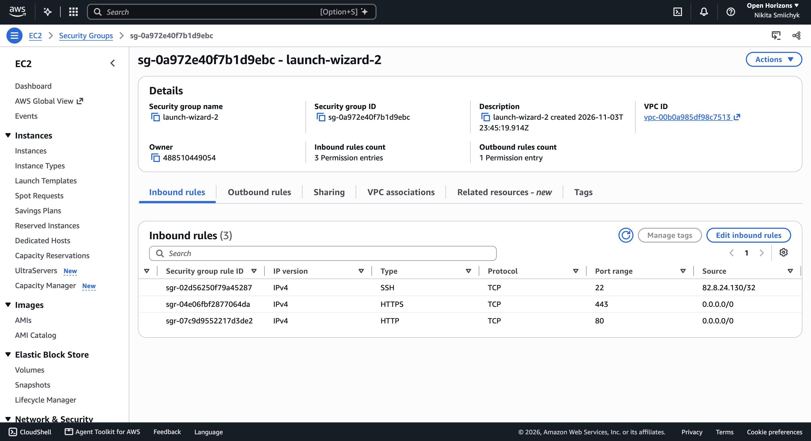
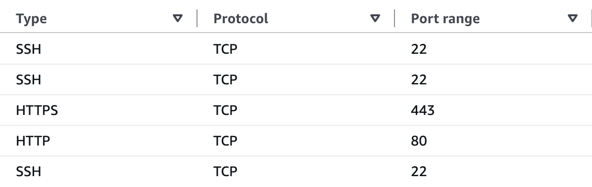
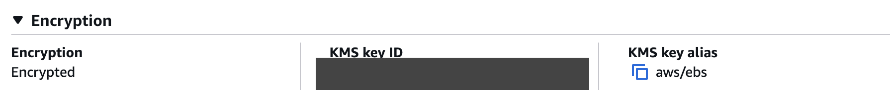

# UniStow deployment

Docker Compose runs FastAPI, PostgreSQL 16, Nginx and Eclipse Mosquitto on one
Ubuntu EC2 instance. PostgreSQL uses an internal Docker network. Certbot renews
the public certificate used by Nginx and Mosquitto.

## Server and DNS

The initial deployment on 4 November 2026 uses instance `i-0455c51903253118b`
in `eu-north-1`, Elastic IP `13.61.161.1`, and `/opt/unistow` as the application
directory. The public URL is https://unistow.app; `www` redirects to this address.
Both DNS records use DNS-only mode. Both names share a Let's Encrypt certificate.

The deployed application uses Stripe sandbox payments and communicates with Locker 4.
Keep its device key in the private production environment file.

Use Ubuntu 24.04 LTS, at least 2 GiB RAM and 20 GiB storage. Allow TCP ports 80 and
443 publicly and restrict SSH (22) to authorised source addresses. For MQTT,
allow TCP 8883 from the Pi network's public egress address. Do not expose 5432 or 8000.
Keep the instance metadata service on IMDSv2. Install Docker Engine and the Compose
plugin using Docker's official Ubuntu instructions.

In Cloudflare, point the apex A record (`@`) to the server's public IPv4 address and
add a `www` CNAME pointing to `unistow.app`. Start with DNS-only records so Certbot can
obtain certificates directly. If proxying is enabled later, use Full (strict) TLS.
An automatically assigned EC2 IPv4 address can change after a stop/start; use an
Elastic IP for a stable address, accounting for AWS IPv4 charges.

## Configuration and first start

Copy the project to `/opt/unistow`. Create a private `.env.production` file there
with permissions `600` containing the following variables. Generate a separate,
strong database password. Never commit this file or put secrets in EC2 user data.

```dotenv
POSTGRES_PASSWORD=
STRIPE_SECRET_KEY=
STRIPE_WEBHOOK_SECRET=
UNISTOW_DEVICE_KEY=
MQTT_APP_PASSWORD=
UNISTOW_OPEN_TEST=1
UNISTOW_MQTT_OPEN=0
```

These flags select delivery-test mode for commissioning. The deployed Locker 4
uses `UNISTOW_OPEN_TEST=0` and `UNISTOW_MQTT_OPEN=1`. Its production environment
also sets `UNISTOW_OVERDUE_BILLING=1` for daily Stripe sandbox charges.
Stripe must use sandbox keys. The device key must match the physical controller.
The webhook signing secret must belong to the deployed endpoint, not Stripe CLI.

Before starting PostgreSQL on a new EC2 host, create its private key and self-signed
certificate on the host. The certificate identifies the Compose service `db`.
FastAPI trusts the mounted public certificate and checks the hostname. Only the
database container receives the private key. PostgreSQL rejects unencrypted TCP
connections and uses the existing cluster rules for authentication over TLS.

```sh
sudo install -d -m 700 /etc/unistow/postgres-tls
sudo sh -ec 'cd /etc/unistow/postgres-tls
  test ! -e server.key && test ! -e server.crt || exit 1
  umask 077
  openssl req -x509 -newkey rsa:3072 -nodes -sha256 -days 365 \
    -subj /CN=db -addext subjectAltName=DNS:db -addext extendedKeyUsage=serverAuth \
    -keyout server.key -out server.crt
  chown 999:999 server.key
  chmod 600 server.key
  chmod 644 server.crt'
```

Renew this database certificate before expiry. Generate a replacement pair in a
separate directory, keep the old pair for rollback, then install the new files and
recreate both `db` and `app` together so their bind mounts use the new pair.

Before starting FastAPI, generate a separate certificate for the internal HTTPS
listener. Nginx verifies the service name `app`. The container health check
verifies the loopback address. Only FastAPI receives the private key.

```sh
sudo install -d -m 700 /etc/unistow/app-tls
sudo sh -ec 'cd /etc/unistow/app-tls
  test ! -e server.key && test ! -e server.crt || exit 1
  umask 077
  openssl req -x509 -newkey rsa:3072 -nodes -sha256 -days 365 \
    -subj /CN=app -addext subjectAltName=DNS:app,IP:127.0.0.1 \
    -addext extendedKeyUsage=serverAuth -keyout server.key -out server.crt
  chown 10001 server.key
  chmod 644 server.crt'
```

Renew the internal FastAPI certificate before expiry. Keep the previous pair for
rollback, install the replacement and recreate both `app` and `nginx` so they
use the same certificate. Certbot renews the public certificate separately.

On a new server, obtain the certificate before starting the production proxy.
Run the following from the application directory with port 80 available.
The temporary Nginx container serves the ACME challenge for both domain names.

```sh
sudo apt-get update && sudo apt-get install -y certbot
sudo mkdir -p /var/www/letsencrypt
sudo docker run -d --name unistow-acme-bootstrap -p 80:80 \
  -v /var/www/letsencrypt:/usr/share/nginx/html:ro nginx:stable-alpine
sudo certbot certonly --webroot -w /var/www/letsencrypt --cert-name unistow.app \
  -d unistow.app -d www.unistow.app
sudo docker rm -f unistow-acme-bootstrap
```

Install the renewal hook and enable the timer. Verify renewal after Nginx starts
with `sudo certbot renew --cert-name unistow.app --dry-run`.

```sh
sudo install -m 755 deploy/reload-nginx /etc/letsencrypt/renewal-hooks/deploy/reload-unistow-nginx
sudo systemctl enable --now certbot.timer
```

Provision the [MQTT broker](#self-hosted-mqtt) before this first Compose start.

```sh
sudo docker compose --env-file .env.production -f compose.production.yaml -p unistow up -d --build
sudo docker compose --env-file .env.production -f compose.production.yaml -p unistow ps
```

On an empty volume, PostgreSQL creates the schema and nine locker records. Only
Locker 4 is enabled. Existing local accounts and rentals are not copied by these
commands. Do not connect the physical controller to two backends simultaneously.

Register `https://unistow.app/api/stripe/webhook` in the Stripe sandbox with events
`checkout.session.completed`, `checkout.session.expired`,
`checkout.session.async_payment_succeeded` and
`checkout.session.async_payment_failed`. Save its signing secret and recreate the
app container. Set the Pi's `server_url` to `https://unistow.app` for HTTPS
heartbeats and collection.

## Checks

Verify HTTPS, registration, sign-in, Secure/HttpOnly session cookies, locker
availability and Stripe sandbox payment confirmation. Check hardware heartbeat,
opening and collection in person before demonstrating physical access.

The app accepts forwarded headers because its port is accessible only within the
private Docker networks. Do not publish the app port directly.

## EC2 inbound access

On 6 November 2026, the EC2 console showed three inbound rules for
`launch-wizard-2`. The group permits public IPv4 traffic on TCP ports 80
and 443 and restricts SSH (TCP port 22) to a single IPv4 address (`/32`).
The group has no inbound rule for PostgreSQL (5432) or FastAPI (8000).



On 10 November the console showed five IPv4 inbound rules. HTTP (80) and
HTTPS (443) were public, and three individual /32 source addresses could use
SSH (22). This screenshot predates the Pi's successful TLS connection on port
8883 later that evening.



## Storage encryption

On 6 November 2026, the EC2 console showed **Encrypted** for the 20 GiB gp3
root volume attached to `unistow-server` at `/dev/sda1` in `eu-north-1`.
The volume uses the AWS-managed EBS key (`aws/ebs`). This provides encryption
at rest for the PostgreSQL data stored on that disk.



## Backups and updates

Before an update, take a database backup and copy it to a separate secure location:

```sh
umask 077
sudo docker compose --env-file .env.production -f compose.production.yaml -p unistow exec -T db pg_dump -U unistow -d unistow -Fc > unistow-backup.dump
```

Test restoration into a separate database. The PostgreSQL volume survives container
recreation, but it is not a backup and does not protect against disk loss.
Never use `docker compose down -v` on this deployment.

After updating the source, rerun the build/start command. Database schema changes
require explicit migrations; initialisation scripts run only on an empty volume.

References: [Docker on Ubuntu](https://docs.docker.com/engine/install/ubuntu/),
[Certbot renewal](https://eff-certbot.readthedocs.io/en/stable/using.html#renewing-certificates), and
[Stripe webhooks](https://docs.stripe.com/webhooks).

## Self-hosted MQTT

The Compose service `mosquitto` runs Eclipse Mosquitto on EC2. Both the Pi and
FastAPI verify the TLS certificate for `unistow.app:8883`. A network alias
lets FastAPI reach the broker directly on the Compose network. The broker mounts
a copy of the domain certificate and key, and its own hashed password file. The ACL grants the app write
access to commands and read access to events. The device has the reverse grants.
The broker disables anonymous access, retained messages and persistent storage.
The clients use clean sessions and QoS 0. Expired or uncertain opening commands
are never retried automatically.

After obtaining the public certificate and before running the updated production
Compose file, provision two different MQTT passwords using the prompts below.
Run the `-c` command only for a new password file. To rotate an existing user,
omit `-c`, update its client and reload the broker.

```sh
sudo install -d -o 1883 -g 1883 -m 700 /etc/unistow/mqtt
sudo install -o 1883 -g 1883 -m 600 /etc/letsencrypt/live/unistow.app/privkey.pem /etc/unistow/mqtt/server.key
sudo install -o 1883 -g 1883 -m 644 /etc/letsencrypt/live/unistow.app/fullchain.pem /etc/unistow/mqtt/server.crt
sudo docker run --rm -it --user 1883:1883 -v /etc/unistow/mqtt:/keys --entrypoint mosquitto_passwd eclipse-mosquitto:2 -c /keys/passwords unistow-app
sudo docker run --rm -it --user 1883:1883 -v /etc/unistow/mqtt:/keys --entrypoint mosquitto_passwd eclipse-mosquitto:2 /keys/passwords unistow-locker-4
```

Save the app password as `MQTT_APP_PASSWORD` in the private `.env.production`.
Put the device password on the Pi using
the [controller instructions](../hardware/README.md#connect-locker-4-to-mosquitto).
Install the Certbot renewal hook above so both services pick up renewed
certificates. Allow TCP 8883 from the Pi's network before the Pi test.

Start in delivery-test mode with `UNISTOW_OPEN_TEST=1` and `UNISTOW_MQTT_OPEN=0`.
Bring up the production Compose stack, verify the broker logs and run **Test open
delivery** with the Pi configured for test mode. Then set
`UNISTOW_OPEN_TEST=0` and `UNISTOW_MQTT_OPEN=1`, recreate the app, and set the
Pi to physical mode. Check the empty-locker opening and collection cycle.
The Pi uses HTTPS for heartbeats and collection in both MQTT modes.

### EC2 deployment on 10 November 2026

Docker Compose started `mosquitto` alongside the running `app`, `db` and
`nginx` services. The broker uses the certificate for `unistow.app` and the
renewal hook refreshes its copy. Two test clients on the EC2 Docker network
verified the certificate and exchanged a test command and a matching
acknowledgement using the app and device identities. The broker rejected
anonymous access. The public website returned HTTP 200 after the rollout.

The Pi then connected to `unistow.app:8883` from its own network and verified
the TLS certificate. The app's delivery test received a matching acknowledgement
from the Pi without actuating the latch. After the controller service restarted in
physical mode, EC2 received a fresh `open` reading with `ready=true`. The live
FastAPI container connected as `unistow-app` with `UNISTOW_MQTT_OPEN=1`, and
the public site returned HTTP 200. After the prototype wiring was corrected, the
broker received `closed` and PostgreSQL recorded rental 45 as completed at
22:45 Dublin time. A physical opening from the website during an active paid
rental still needs to be demonstrated with Mosquitto.

EC2 instance metadata identified `launch-wizard-2` as the attached security
group. If the Pi moves to a different network, check that this group allows
TCP 8883 from the new network's public egress address.

### Local broker check

Local Compose publishes MQTT on loopback. Create the local secrets directory
once and use two development passwords. The certificate identifies localhost.
The production setup above uses the public domain certificate instead.

```sh
mkdir -m 700 .local-mqtt
openssl req -x509 -newkey rsa:2048 -nodes -sha256 -days 30 -subj /CN=localhost \
  -addext 'subjectAltName=DNS:localhost,IP:127.0.0.1' \
  -keyout .local-mqtt/server.key -out .local-mqtt/server.crt
docker run --rm -it -v "$PWD/.local-mqtt:/keys" --entrypoint mosquitto_passwd eclipse-mosquitto:2 -c /keys/passwords unistow-app
docker run --rm -it -v "$PWD/.local-mqtt:/keys" --entrypoint mosquitto_passwd eclipse-mosquitto:2 /keys/passwords unistow-locker-4
docker run --rm -v "$PWD/.local-mqtt:/keys" --entrypoint sh eclipse-mosquitto:2 -ec 'chown -R 1883:1883 /keys && chmod 600 /keys/server.key /keys/passwords'
docker compose up -d mosquitto
```

Set `MQTT_HOST=localhost`, `MQTT_APP_PASSWORD` and the absolute path to the
public certificate in `MQTT_CA_FILE` for the local backend. Select delivery-test
or physical mode as above. The local TLS test on 10 November used the actual
server and Pi MQTT code, with simulated GPIO. It received telemetry, acknowledged
the test command without movement and acknowledged a simulated physical opening.
The broker rejected anonymous and invalid logins and blocked each client's
attempt to publish to the other client's topic.

## Daily overdue test billing

Before enabling daily test charges, apply database migrations 002 and 003.
Set `UNISTOW_OVERDUE_BILLING=1` in `.env.production` and recreate the app
container. The default is 0. The worker runs every minute and uses a database
lock to coordinate multiple application processes. See the
[billing rules and verification](../docs/database.md#daily-test-billing).

## Outstanding payment recovery

Before deploying Pay outstanding, back up the database and apply
`database/migrations/004_overdue_payment_recovery.sql` using the
production PostgreSQL container, as for earlier migrations. Deploy the app only
after the migration succeeds. The migration does not change existing charges.

The signed Stripe Checkout webhook also handles outstanding payments. Verify a
failed test charge through Checkout, confirm its balance clears after Stripe
confirmation and check that Finish rental stays available. A browser return URL
alone must never mark the charge paid.
