# Usability testing

This is a dated record of observations and verification, not a description of
every current screen. Earlier entries include PayBox, PubNub and previous colours.
Test totals refer to separate runs, not a combined or current test count.
Outstanding checks are tracked in the [submission checklist](implementation-plan.md).

## 25–26 October 2026 — Local PayBox prototype

These checks took place before the November phone session, when the backend ran on the Mac. Most were developer
walkthroughs. Artur tested the physical door.

| Check                         | Observation and follow-up                                                                                                                                                                                                 |
|-------------------------------|---------------------------------------------------------------------------------------------------------------------------------------------------------------------------------------------------------------------------|
| Registration                  | A new account returned 201; a duplicate email returned 409. Invalid input initially returned 500, then 422 after the fix. The tester confirmed the email error and form submission.                                       |
| Session                       | Sign-in survived refresh; sign-out remained effective after refresh. A wrong password showed **Incorrect email or password**. Resuming a booking needed a separate check.                                                 |
| Signed-out booking            | Selecting Locker 4 before sign-in returned the renter to that locker's rental form afterwards.                                                                                                                            |
| Reserve and continue          | Replaced a demo response with a stored **Pending** rental and **Unavailable** locker. Added **Continue rental** for the owner. Returning after sign-out and checking access from a second account remained follow-ups.    |
| Expired unpaid hold           | After 15 minutes without checkout, Locker 4 became available. Reserving again cancelled the old record and created a pending one. Both records were checked.                                                              |
| Stripe sandbox payment        | Checkout showed the expected price. After refresh, the rental became **Active** and **Pay** disappeared. Clearer Checkout branding and automatic updates were later changes, not verified in this check.                  |
| Door sensor                   | The displayed state followed physical opening and closing; the latch returned after opening. This did not test a door held just short of closure.                                                                         |
| Slow closure, tested by Artur | The magnet triggered before the door was seated. The lowered latch blocked closure and the arm needed refitting. A stable-closure check and another opening request were added; November introduced automatic retraction. |
| Servo and reboot              | Initial trembling and an incorrect direction were resolved with pigpio and tested pulse settings. A roughly 30 cm extension worked. After reboot, pigpiod was active and the hardware test worked.                        |
| Database outage               | The site showed a service-unavailable page and heartbeats returned 503, then recovered with PostgreSQL. A separate rental-page 500 had no confirmed cause in this record.                                                 |

The October walkthrough also shaped the interface: keep the rental deadline and price easy to find, show the account
menu from the person icon, keep **My rentals** on its own page, and hide device and door details before payment. The
renter asked for an in-page **Finish rental** dialogue and automatic updates after having to refresh manually. The
November observations below record which of these changes were subsequently checked on a phone.

## 6 November 2026 — UniStow phone session and follow-up checks

A renter used unistow.app on a phone to open Locker 4, close it, collect their belongings and finish the rental. The
physical door opened, held shut after closing and the rental eventually showed **Completed**. The interface review
around that journey focused on three questions: Which locker can I use? What should I do next? How do I back out safely?

This record separates the renter’s observations from design changes and browser checks. The phone journey took place
during development. Later refinements were deployed through commit `7dd8e97`.

### Finding a locker and moving around

| Observation                                                                 | Change                                                                                                  |
|-----------------------------------------------------------------------------|---------------------------------------------------------------------------------------------------------|
| The phone substituted a blue arrow emoji for the desktop arrow.             | Replaced it with an SVG that inherits the link colour.                                                  |
| Locker cards looked tall and narrow, with an extra divider below.           | Made the cards square and removed the divider. Availability uses words as well as colour.               |
| My rentals changed the header and removed the account icon.                 | Shared the branded header and bottom navigation across the list pages; removed the redundant back link. |
| Booking and payment repeated the locker number and changed the header size. | Reused the shared header, kept the short page hint and used a round back button on detail pages.        |
| The U looked off-centre.                                                    | Centred it and reused the mark in the header and browser tab.                                           |

### Reserving, paying and changing your mind

- **Before payment.** Someone who changes their mind during the 15-minute reservation can use **Cancel reservation**
  below **Pay**. This releases the locker for someone else without waiting for the reservation to expire.
- **Confirming cancellation.** A styled dialogue asks **Cancel your reservation?** and explains who can use the locker
  afterwards. The white **Keep** button closes the dialogue. The pale orange **Cancel** button confirms cancellation.
  Short labels avoid repeating “reservation” three times. The main payment action stays dark green.
- **After payment.** The message above the buttons has the same breathing room as the pre-payment guidance. **Payment
  confirmed. Your rental is active.** appears once per rental in that browser tab. Opening and closing the door should
  not bring back an old payment announcement.
- **Reading feedback.** Opening, collection and payment updates occupy the message area above the relevant buttons. Each
  new instruction replaces the previous one. This keeps the next step in view instead of making the renter look below
  the controls for a second explanation.

### Opening the door, closing it and finishing

| Situation                              | Decision or observed result                                                                                                                                               |
|----------------------------------------|---------------------------------------------------------------------------------------------------------------------------------------------------------------------------|
| Tap **Open locker**.                   | Show **Unlocking…**, then **Open the door once it unlocks.**                                                                                                              |
| Door already open.                     | Disable opening and explain **Your locker door is open**, including on return to the page.                                                                                |
| Close the door.                        | Show **Securing your locker…** while relocking instead of briefly flashing a not-ready warning. The renter checked both **Closed** and the physical hold.                 |
| Door comes ajar after a light closure. | Retract the latch when the sensor reports open during or after closing, including at startup. A sensor reading alone does not prove a secure latch.                       |
| Choose **Finish rental**.              | Ask for confirmation. The pale orange action ends the rental; the white **Cancel** dismisses the dialogue. Cancel/Keep controls have no brown outline or underline.       |
| Collect belongings.                    | Keep **Take all your belongings, then close the door to finish your rental.** above disabled actions. The renter confirmed that opening and closing led to **Completed**. |

**Finish rental follow-up on the phone.** The renter confirmed that after confirming **Finish rental** and opening
the door, the button stayed visible and disabled. Tapping it again could not reopen the confirmation dialogue.
A regression test also checked that the button stays disabled when the Pi reports an open door while the database
still shows it as closed.

### Touch, dialogues and interrupted connections

| Check                   | Result and scope                                                                                                                                                                                                                                                             |
|-------------------------|------------------------------------------------------------------------------------------------------------------------------------------------------------------------------------------------------------------------------------------------------------------------------|
| Pull-to-refresh         | Suppressed overscroll; a downward pull of at least 80 CSS pixels refreshes on release. Six scripted cases covered a valid pull, a short pull, sideways/upward movement, a start partway down and a two-finger gesture.                                                       |
| Dialogue interaction    | Chrome confirmed scroll locking, no dismissal for an inside tap, and backdrop dismissal without losing scroll position. Dismissal did not confirm the action.                                                                                                                |
| Initial button focus    | Chrome showed no outline, border width or underline on **Keep** and **Cancel**. The published stylesheet matched the checked version.                                                                                                                                        |
| Connection interruption | Background refreshes retained the last content and retried quietly. Scripted failure/503 checks preserved existing payment messages and could disable unverifiable controls. Requested actions still reported failures. The later repeated-failure notice is recorded below. |

### Physical tests on the earlier PubNub deployment

1. **Read the door.** The Pi published a closed-door reading. The backend logged it and the renter saw **Closed** on the
   active rental page.
2. **Check delivery before moving the latch.** A ping received a matching pong in 0.22 seconds. Test clicks from the
   rental page received acknowledgements in the controller log. These checks established delivery. The separate physical
   test confirmed movement.
3. **Open from the public site.** After the old empty test rental was closed, the renter made a fresh rental, tapped
   **Open locker** on the phone and observed Locker 4 open. After closing it, they checked both the displayed state and
   the physical latch.
4. **Finish from the phone.** The renter tapped **Finish rental**, opened and closed the door and reported
   **Completed**. This checked the outcome beyond the initial button press.
5. **Keep the locker usable after the first hour.** Automatic renewal was enabled for the controller’s one-hour PubNub
   token. The setup reported **Automatic token renewal active on Locker 4**. An opening after the original token expired
   was not recorded.

### 7 November 2026 — Opening Locker 4 while its controller was stopped (#7)

With a paid, active rental, the renter tapped **Open locker**. The phone displayed
“Delivery is uncertain. Check the locker.” A separate check on the Pi showed the controller service was inactive.

| Raspberry Pi desktop (setup)                                               | Controller status                                                                               | Renter’s phone after tapping Open locker                                                     |
|----------------------------------------------------------------------------|-------------------------------------------------------------------------------------------------|----------------------------------------------------------------------------------------------|
| 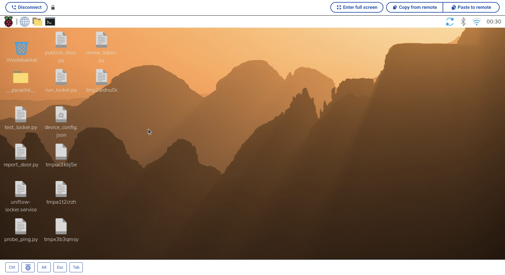 | 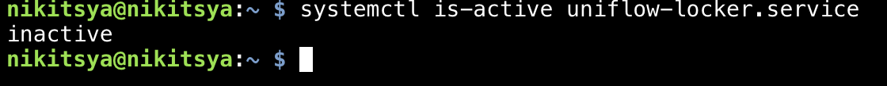 | 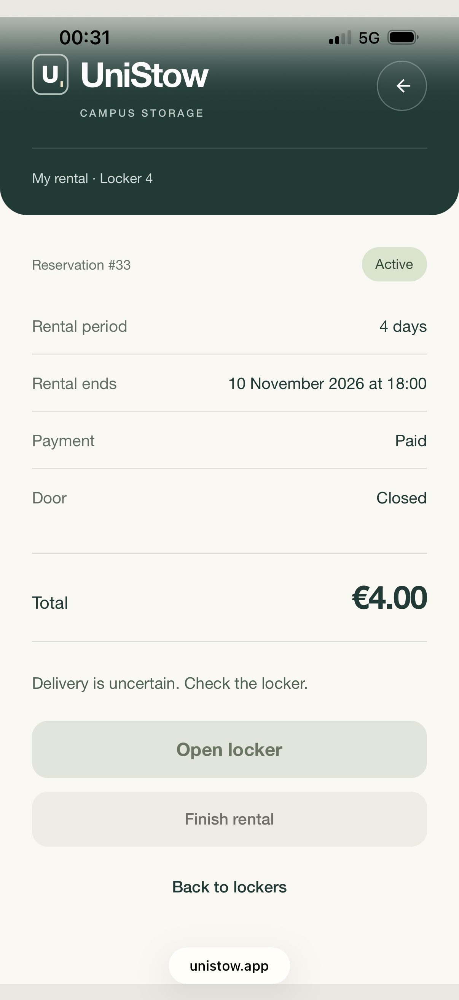 |

**Reconnection test passed.** After the original request expired, the renter restarted the controller on the Pi and
confirmed the service was active. The latch stayed in place until the renter tapped **Open locker** again on the phone.
The renter then saw the latch turn.

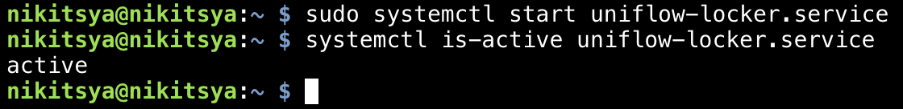

### Verification notes and remaining checks

The saved development runs include 58 passing tests for token renewal, 60 for rental notices and 61 in the
payment-confirmation run. These totals are separate runs of overlapping suites. Earlier runs skipped database-dependent
cases, and one physical-command test run recorded 17 errors when the test process could not connect to local PostgreSQL.
The phone observations above come from the real locker, independently of those automated runs.

After that deployment, the published dialogue, payment and live-update assets
matched the checked release. The [submission checklist](implementation-plan.md#additional-prototype-testing)
retains the phone, cancellation and light-closure checks still needing a result.
The one-hour token-renewal check applied to PubNub and is no longer part of the
Mosquitto setup.

## Service interruptions — 9 November 2026

Issue #16 adds calm status messages above rental actions. A first failed refresh
blocks actions while retrying quietly. Repeated failures show one message.
Locker cards show that availability is being checked until a successful refresh.
An enabled locker with a missing or expired heartbeat is temporarily unavailable,
and the server rejects new reservations for it.

An opening with an unknown outcome tells the renter to check the door before
trying again. This message survives background refreshes until an opening or
collection is confirmed, or the renter explicitly makes another request.
The browser never retries an opening automatically.

Rental page failures offer a retry of the same page and a link to phone support.
Payment and collection status still depend on confirmed server responses.

### Verification

- All 65 backend tests passed with local PostgreSQL enabled, including the
  offline reservation rejection and availability recovery test.
- Automated page tests cover database and unexpected errors, a same-page retry
  and the support link, without exposing the exception text.
- Chrome with a 390 × 844 viewport and simulated network failures passed the
  brief-interruption, repeated-failure and recovery checks.
- The same browser check confirmed that an unknown opening retains its warning
  after refresh and sends exactly one opening request.
- Physical-phone checks with the deployed site and an offline Pi are pending.

Content follows
the [GOV.UK service problem guidance](https://design-system.service.gov.uk/patterns/problem-with-the-service-pages/).

## Billing verification — 9–10 November 2026

All payments in this record used Stripe test mode. Local automated checks used
isolated PostgreSQL schemas and mocked Stripe responses.

| Run                                       | Result and scope                                                                                                                                                                     |
|-------------------------------------------|--------------------------------------------------------------------------------------------------------------------------------------------------------------------------------------|
| 9 November: saved payment methods         | 70 tests passed, covering consent, verified storage, duplicate events, lookup retries, mismatched Customers and legacy payments.                                                     |
| 9 November: daily billing                 | 86 tests passed, covering Dublin clock changes, missed days, competing workers, retries, declined/processing payments and completion races. Migration 003 was applied twice locally. |
| 10 November: overdue collection           | 87 tests passed before commit `8bba849` was deployed. Collection remained subject to ownership, payment and controller checks.                                                       |
| 10 November: payment summary              | 89 tests passed, covering mixed statuses, waived amounts, completed rentals and access restrictions. Release `8972ef3` included feature commit `545f1d7`.                            |
| 10 November: outstanding-payment recovery | 101 tests passed. A local 390 × 844 Chrome preview checked the layout, Finish rental dialogue, double-click handling and checkout failure/retry with simulated Stripe responses.     |

Separate EC2 checks found Customer and PaymentMethod IDs and a saved timestamp
on the payment records for rentals 41 and 45.

**Manual EC2 billing check, rental 41.** Commit `5e1d586` and migration 003
were deployed on 9 November. Automatic billing was disabled. After saving a
backup, the related rental dates were moved back one day to make a EUR 1 charge
due. Two manual worker runs produced one paid record and one successful
PaymentIntent receiving 100 cents. The second run reused both records.

A further backed-up date adjustment simulated another missed deadline. The
worker added one EUR 1 payment for 8 November and retained the 9 November
payment. Repeating the run left exactly two successful test payments totalling
EUR 2. The physical controller was not operated during these billing checks.

The renter subsequently completed rental 41; EC2 recorded completion at
00:08:15 UTC on 10 November. Two further manual runs left those payments
unchanged and created no additional charge. Automatic billing remained disabled.

**Worker activation.** On 10 November, `UNISTOW_OVERDUE_BILLING=1` was set in
the backed-up EC2 environment and the app was recreated. Health and HTTPS checks
passed. No active/overdue rentals or pending charges existed at activation; the
four paid daily records stayed unchanged. Rental 45 later tested the actual
deadline, as recorded [below](#after-the-automatic-billing-deadline--rental-45).

## Extra-day payment summary — 10 November 2026

### Deployed-site check

Test rental 43 was moved into overdue status by adjusting its dates. One EUR 1
extra-day payment was then collected manually through the billing service in
Stripe test mode. Stripe confirmed `succeeded` with `livemode=false`; no real
money was collected. The automatic billing worker remained disabled.

The supplied desktop-browser screenshot of `unistow.app/rentals/43` shows:

- **Rental cost:** EUR 1.00.
- **Extra days · paid:** EUR 1.00.
- **Total:** EUR 2.00, including both amounts.
- **Payment:** Paid, alongside the separate **Overdue** rental status.
- **Open locker:** disabled after the paid period ended.
- **Finish rental:** available so the renter can collect their belongings.

The message above the buttons explains that the paid rental period has ended
and asks the renter to finish the rental to stop daily charges. Paying an
extra-day charge does not mark the rental as completed.

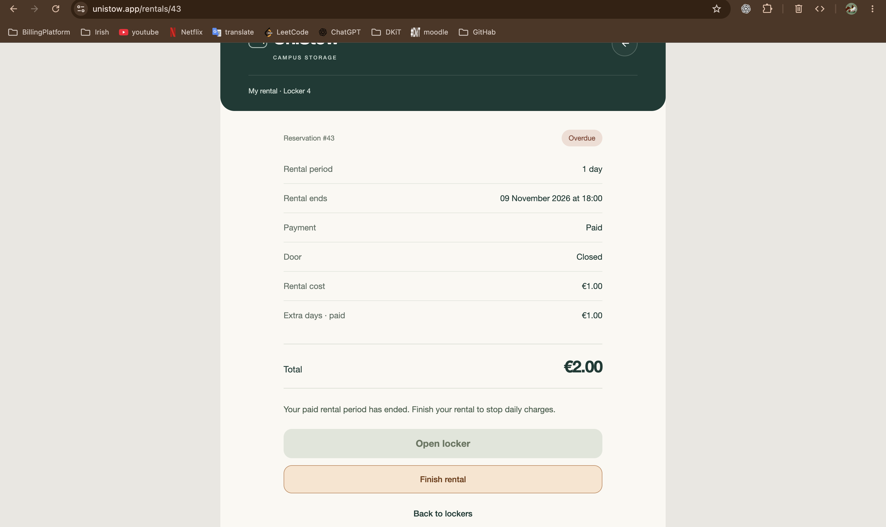

*Evidence supplied on 10 November 2026: the deployed desktop page after one
successful test-mode extra-day payment.*

This screenshot confirms the paid-charge presentation. It does not verify the
processing or failed-payment presentation, a physical-phone layout, or automatic
execution at the next daily deadline. Local checks are recorded
[above](#billing-verification--910-november-2026);
the actual deadline check for rental 45 is [below](#after-the-automatic-billing-deadline--rental-45).

## Why Finish rental remains available with unpaid charges

On 10 November I considered blocking Finish rental until the extra-day charge
was paid. I kept collection separate from payment so a declined card would not
trap belongings or force more daily charges to accrue.

Confirmed collection ends the rental and stops new charges. Existing debt remains
payable through **Pay outstanding**. Ordinary opening stays unavailable after
the paid period; collection still requires ownership, confirmed initial payment
and a ready controller. The screenshots below show the failed payment and its
later settlement after collection.

### Failed-payment evidence — rental 44

The deployed-site screenshot below records the outcome after Stripe declined
one EUR 1 extra-day test payment. Following deployment of `bebddb8`, two
reconciliation passes kept the same PaymentIntent and marked the charge as
failed. Stripe reported zero collected for that extra-day payment; no new
PaymentIntent was created during reconciliation.

The page shows **Payment incomplete**, **Extra days · unpaid EUR 1.00** and **Total EUR 2.00**. The total includes the
original EUR 1 rental payment and the
unpaid EUR 1 balance; it does not mean EUR 2 has been collected. Finish rental
remains available, while ordinary opening is disabled.

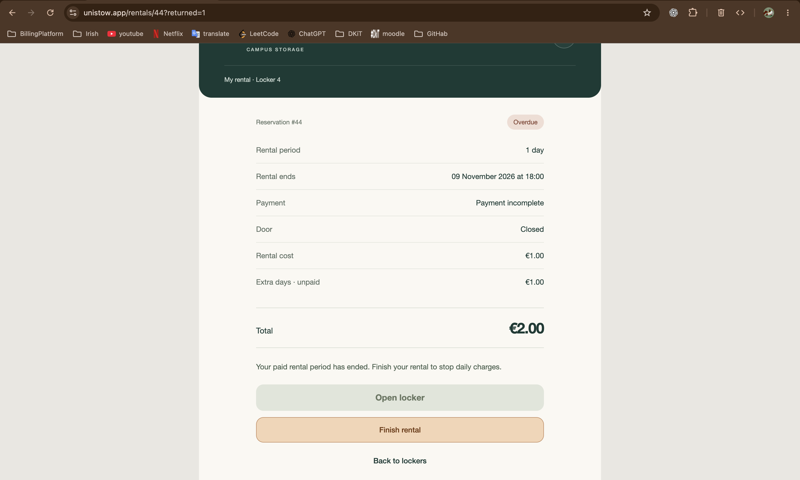

*Desktop evidence supplied on 10 November 2026, before the Pay outstanding
button and revised failed-payment message were added. This screenshot does not
verify successful recovery of the outstanding balance.*

### Paying after collection — rental 44

On 10 November 2026, release `d006a3c` and migration 004 were deployed. The
renter completed rental 44 before paying the outstanding EUR 1. The first
screenshot confirms that completion did not remove the debt: the page showed
Completed, Payment incomplete and Extra days · unpaid EUR 1.00. It retained
Pay outstanding EUR 1.00 and explained that the rental had ended but the balance
still needed paying.

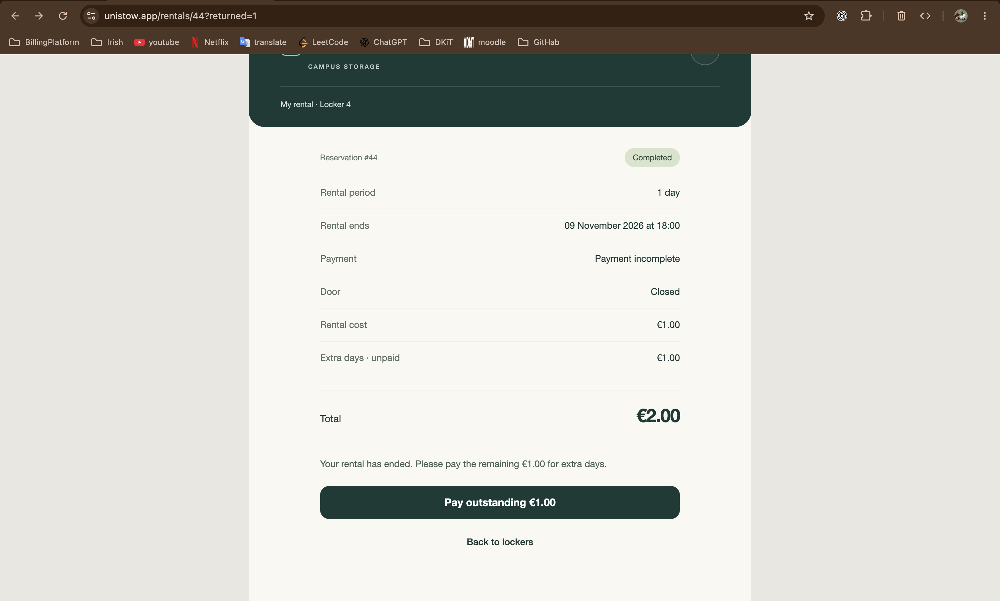

The renter then paid through hosted Stripe Checkout. On return, the page kept
the rental Completed, changed Payment to Paid and Extra days to paid, and removed
the payment button. Total remained EUR 2.00: the original EUR 1 rental cost plus
the now-paid EUR 1 extra-day charge.

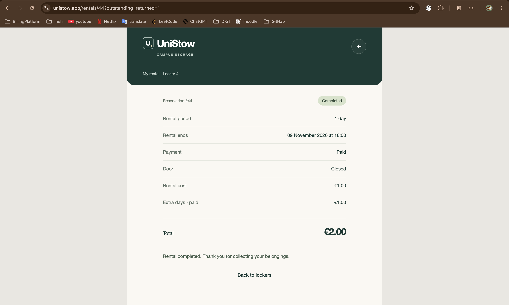

Read-only verification against EC2 and Stripe confirmed one recovery record,
marked paid, and a successful test-mode recovery PaymentIntent with 100 cents
received. The original declined PaymentIntent was cancelled with zero received.
The daily charge was marked paid and the rental remained completed. No new
payment was created by this verification, and no real money was collected.

These desktop captures do not demonstrate automatic billing at a future
deadline or the recovery flow on a physical phone.

### Before the automatic billing deadline — rental 45

The renter supplied this screenshot on 10 November 2026. The desktop menu bar
shows Tuesday 10 November at 01:27. Rental 45 is Active, Payment is Paid and the
door is Closed. The total is EUR 1.00, with the rental ending on 10 November
2026 at 18:00. The screenshot is preserved with its visible date and time.

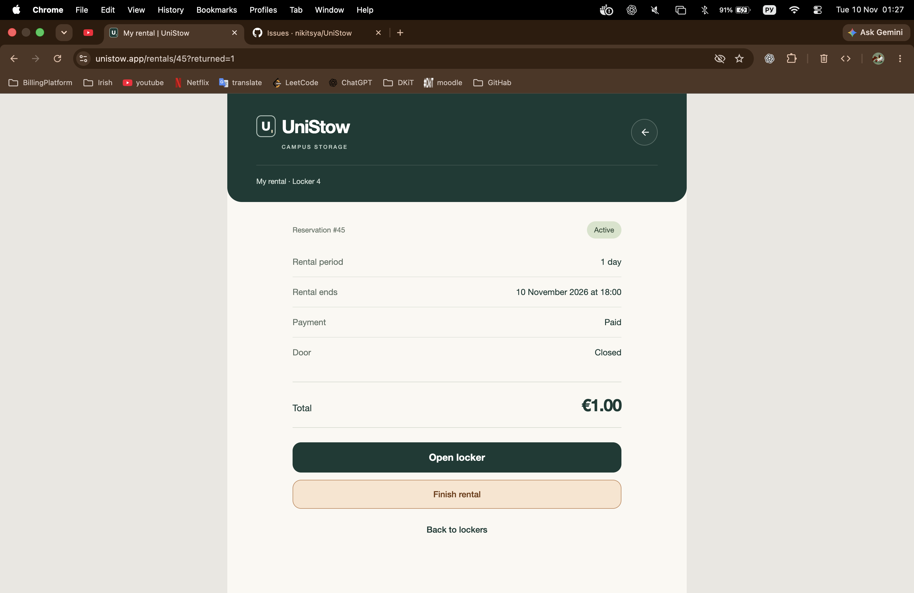

The automatic test billing worker had been enabled on EC2. A preceding
read-only database check confirmed the saved payment method, consent version
and deadline for this rental. The deadline was left unchanged so that the next
check observed a real deadline rather than a manually backdated rental.

Expected result after 18:00 Europe/Dublin: one EUR 1 test charge for the extra
day, Extra days · paid EUR 1.00 and a total of EUR 2.00. Subsequent automatic
passes should retain the same charge without collecting a second payment for
the same rental and date, provided the rental remains active or overdue.

### After the automatic billing deadline — rental 45

At the time of this screenshot the deployed page showed **Overdue**, **Payment · Paid**, **Extra days · paid EUR 1.00**
and **Total EUR 2.00**. The original rental cost
remains EUR 1.00. This matches the expected renter-facing result after the
10 November 2026 deadline at 18:00 Europe/Dublin. At capture, the door state
was Unknown and both locker controls were unavailable.

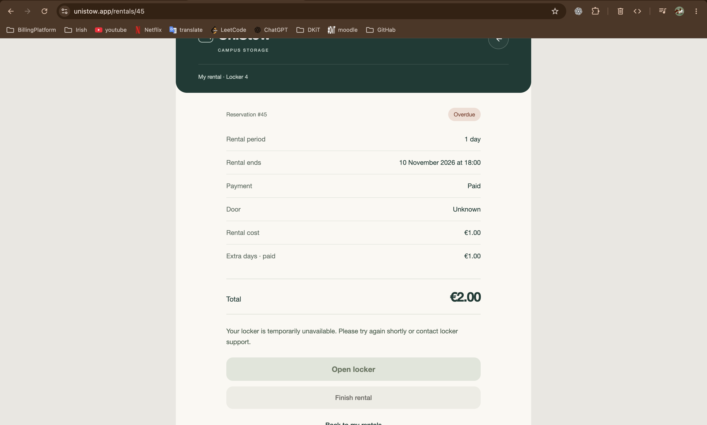

A read-only Stripe sandbox search on the evening of 10 November matched
rental ID 45 and charge date 2026-11-10. It returned exactly one PaymentIntent,
created at 18:00:31 UTC, with status `succeeded` and 100 euro cents received.
Read-only checks at 21:26 and 21:28 UTC found the same paid PostgreSQL row
on EC2 and the same successful test PaymentIntent in Stripe. The worker was
enabled and checks every minute. Both observations found one charge for this
rental and date. This completes the deadline and duplicate-payment check for
issue #14.

Later that evening, the renter reconnected the yellow lead on Locker 4.
Mosquitto then received a fresh closed-door reading with the controller ready.
The HTTPS collection command was dispatched at 22:45:00 Dublin time and
PostgreSQL recorded rental 45 as completed at 22:45:09. Ordinary paid-period
opening over MQTT needs a separate test with an active rental.

### Recent completed rentals — issue #17

I chose five recent completed rentals so a renter can identify an earlier visit
when reporting forgotten belongings or another concern. Each entry contains
the rental reference, locker number and completion time in Europe/Dublin.
The display limit does not delete older database records. Completed rentals
with outstanding charges remain accessible for payment even outside the last five.

Local PostgreSQL fixtures covered completion ordering, seven rentals reduced to
five entries, repeated loads, an empty current list, restored sessions and owner-only
access. A 390 × 844 Chrome preview showed no horizontal overflow. These were
local checks; the signed-out/signed-in check on the deployed site remains in the
[submission checklist](implementation-plan.md#additional-prototype-testing).

After a phone review, completed entries became muted, non-clickable summaries.
They no longer imply that the renter can reopen or finish the rental. Only an
outstanding payment has a separate action, and completed detail pages no longer
display the current door state. Support remains available through Contact.

## 22 November 2026 — Unpaid-balance restriction

Four browser captures of the deployed application were refreshed on 22 November
2026 for issue #19, using a 393 × 852 viewport. They replace the earlier supplied
screenshots and show the revised balance notice, rental history and payment page.
The scenario uses a synthetic completed rental (#50, Locker 5) with one failed
EUR 1.00 charge (#84324) on the test account. Rental #51 for Locker 4 had already
been completed by the author before the updated application was checked.

### Account balance and locker availability

The home page shows **Balance to settle**, EUR 1.00 unpaid and a link to **Rental #50 · Locker 5**. It explains the
booking restriction, retained paid
access/collection and support. **Available 0** and grey cards reflect the restriction;
completed debt is no longer labelled **Continue rental**. Current rentals retain
their management links and normal access checks.

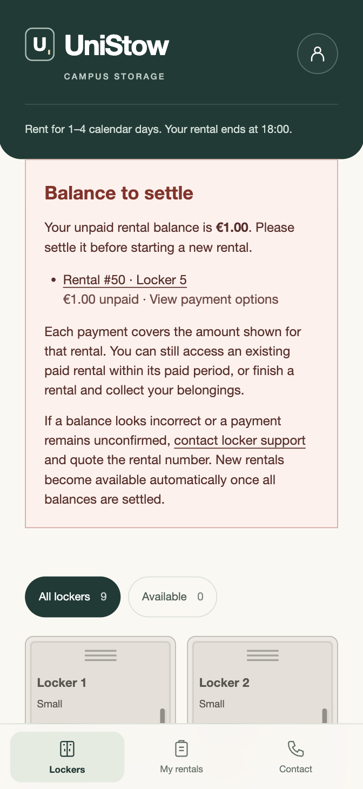

The layout check found matching content widths across the home, My rentals and
Contact pages: 544 pixels at a 1512-pixel viewport and 320 pixels at 360 pixels,
without horizontal overflow.

### Balance above rental history

My rentals places the pale red notice above **No current rentals** and **Recently completed**. The panel and history
cards use square corners. Text,
amounts and links accompany colour, following
the [W3C guidance on use of colour](https://www.w3.org/WAI/WCAG21/Understanding/use-of-color.html).
A separate amber treatment is used for payments awaiting confirmation without
a confirmed unpaid balance; that state is not shown in these captures.

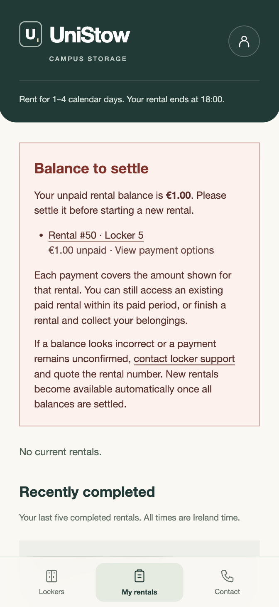

The separate history view shows square completed-rental cards and the shorter
description, **Your last five completed rentals.** Rental #50 retains a **View outstanding payment** link; completed
rentals without debt remain
non-interactive summaries.

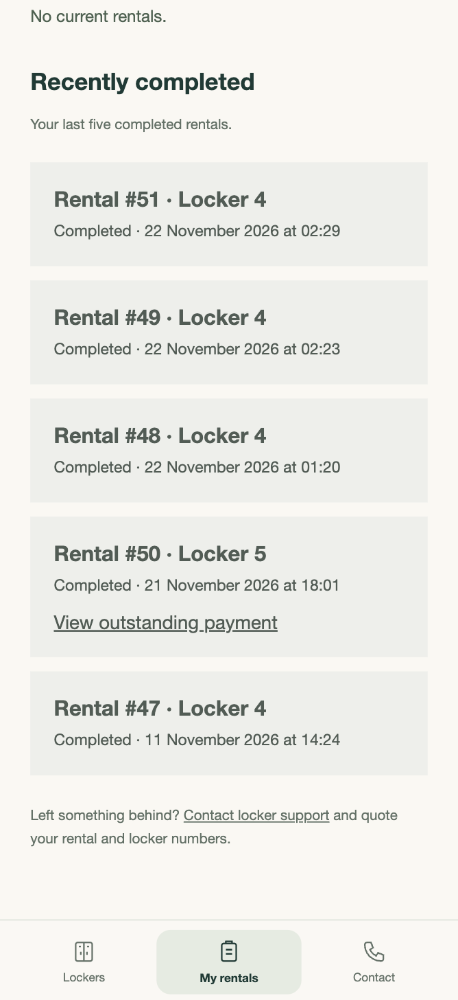

### Completed rental and recovery action

The detail page identifies reservation #50 as **Completed**, with a one-day
rental ending at 18:00 on 21 November 2026. It shows **Payment incomplete**, **Rental cost EUR 1.00**, **Extra days ·
unpaid EUR 1.00** and **Total EUR 2.00**.
The original cost and unpaid amount are separate: the remaining amount requested
by **Pay outstanding EUR 1.00** is EUR 1.00. The page explains that the rental
has ended and links back to My rentals. It does not offer opening or collection
controls for this completed rental. The repeated account-wide balance notice
has been removed from this detail page so that the rental information and
recovery action appear directly below the header.

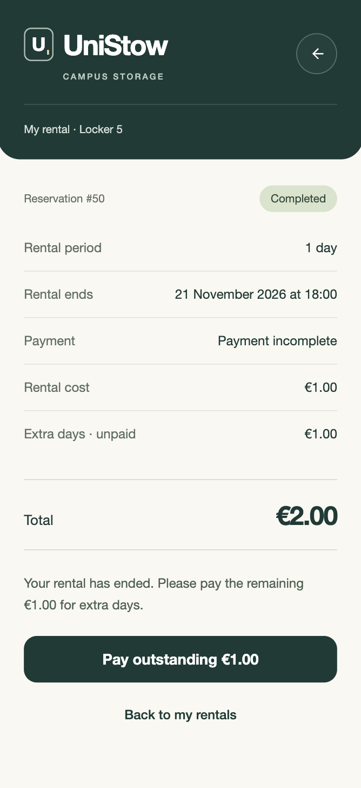

### EC2 check: debt on Locker 5 blocks a new Locker 4 rental

Earlier functional verification passed all 113 backend tests with isolated
local PostgreSQL schemas and mocked Stripe responses. The page tests cover
completed debt on another locker, disabled cards,
balance notice placement, pending-payment styling and availability restoration
after the test charge is waived. Existing paid-rental access remains covered.
Earlier local browser checks also confirmed that settling all preview balances
removed the notice and enabled payment without signing in again.

Live HTTPS checks of the running EC2 application returned 200 for the home,
My rentals and Locker 4 booking pages, each showing the Locker 5 debt. A direct
POST to `/api/rentals` for Locker 4 returned HTTP 409 with
`account_booking_restricted`, `unpaid_cents: 100` and rental #50 in the balance
details. No new rental was created. The short-lived verification session was
removed afterwards; the author's browser session remained signed in.

The refreshed captures record the displayed balance, availability and payment
options. This manually inserted charge has no Stripe PaymentIntent, so it tests
restriction and presentation, not payment recovery or a real card decline.
The visible payment button is not evidence of a successful payment.

After the manual check on 22 November, synthetic charge #84324 was changed from
`failed` to `waived` at the author's request, without recording a payment. The
account then had no unpaid or processing balance. On EC2 the notice disappeared, **Available 1** returned and Locker 4
became selectable again.

### Separate test account — 22 November 2026

The account `test.unistow@example.com` was given a synthetic EUR 1.00 unpaid
charge for completed rental #52 on Locker 5. The reservation service rejected
a new Locker 4 rental with `account_booking_restricted` (409), and no new
rental was created. The home page and My rentals displayed **Balance to settle**;
the Locker 4 booking page showed the balance notice without a reservation form.

The author's main account had no unpaid or processing balance and remained
eligible to book. This confirmed that a debt on Locker 5 blocks new rentals
of other lockers for the same account, while another account remains free
of that balance restriction.

## 27 November 2026 — Locker 4 rental walkthrough (#59)

### Availability before booking

The author supplied a capture of the Lockers page showing **All lockers 9**
and **Available 1**. Locker 4 was labelled **Small**, **EUR 1.00 per day** and
**Available**; the other fully visible cards were labelled **Unavailable**.

The supplied interface captures do not include the browser address bar.
Separate HTTPS and device checks are recorded in the
[27 November architecture verification](../deploy/README.md#architecture-check-on-27-november-2026).

### Booking consent

The form showed two calendar days at EUR 1.00 per day, totalling **EUR 2.00**.
**Reserve locker** appeared disabled while the overdue-charge consent was
unchecked and enabled once it was checked. These captures show the two interface
states; they do not test whether the server rejects a request without consent.

| Consent unchecked | Consent checked |
|-------------------|-----------------|
| 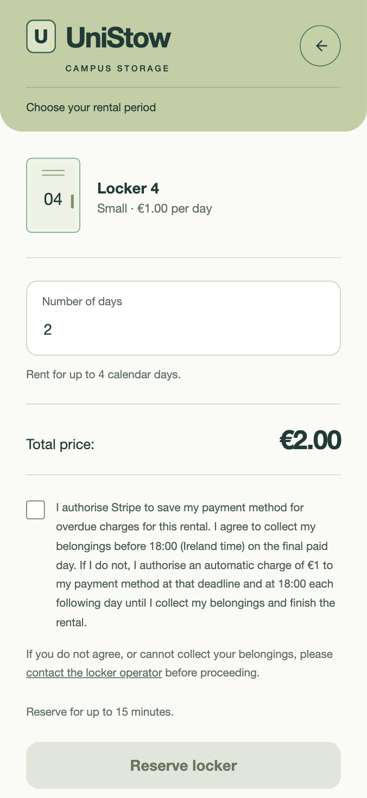 | 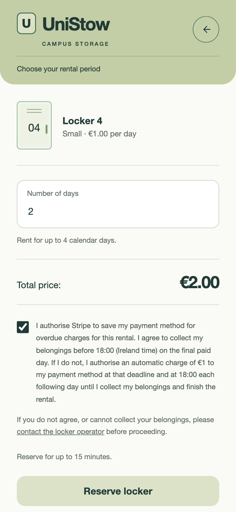 |

### Pending reservation and cancellation dialogue

Reservation **#59** showed **Pending**, **Not paid**, a two-day rental ending
at **18:00 on 29 November 2026**, and a total of **EUR 2.00**. The page offered
payment and cancellation. The cancellation dialogue offered **Keep** and
**Cancel**; no capture shows cancellation being confirmed or the locker being
released through that action.

| Pending reservation | Cancellation dialogue |
|---------------------|-----------------------|
| 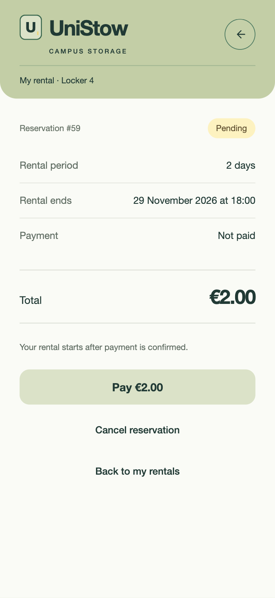 | 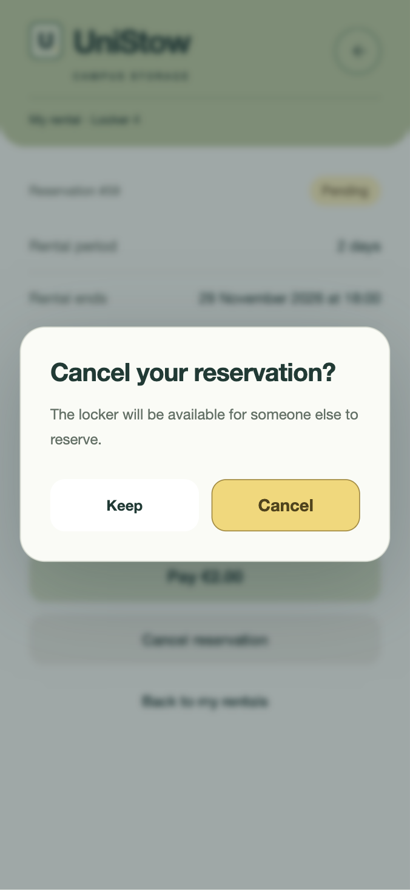 |

### Sandbox checkout and active rental

Stripe Checkout displayed **Sandbox**, **UniStow Locker 4 — 2 day(s)** and
**EUR 2.00**. The subsequent UniStow page for reservation **#59** displayed
**Active**, **Paid**, **Door: Closed** and **Payment confirmed. Your rental is
active.** The total and end date were unchanged, and **Open locker** and
**Finish rental** were shown as available actions.

| Stripe sandbox checkout | Active, paid rental |
|-------------------------|---------------------|
| 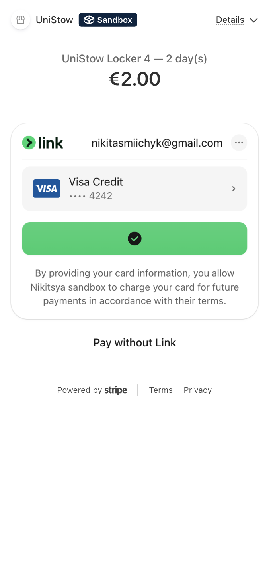 | 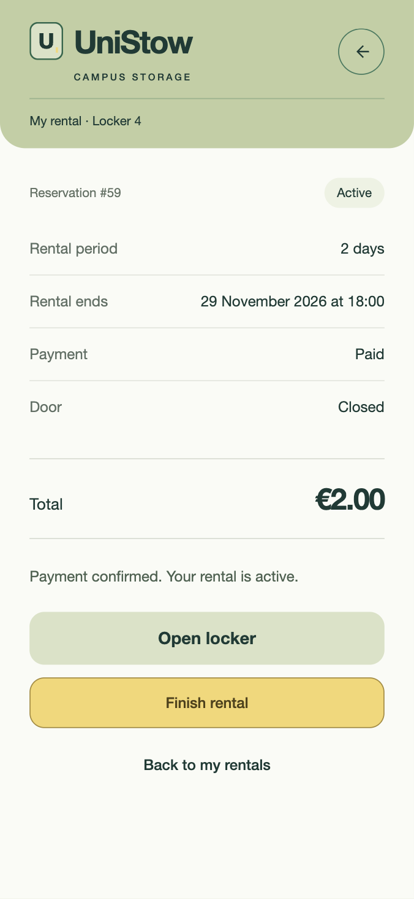 |

### Opening and securing the locker

The opening request showed **Open the door once it unlocks.**, followed by
**Door: Open** and **Your locker door is open.** Both opening and finishing
actions appeared disabled in those captures.

| Opening requested | Door reported open |
|-------------------|--------------------|
| 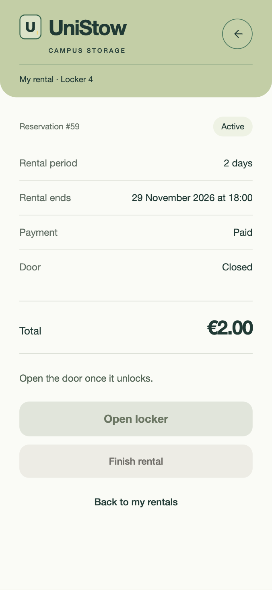 | 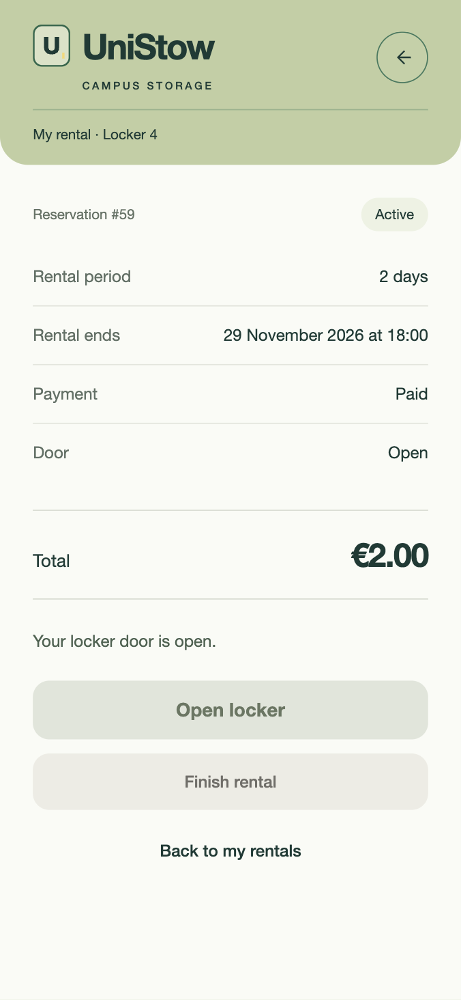 |

After closing, the page showed **Door: Closed** and **Securing your locker…**.
A later capture showed the opening action available while **Finish rental**
remained disabled; the finishing dialogue was accessible in a subsequent capture.
The author separately confirmed that the real door opened after the button
request and that the latch held it shut after closing.

| Securing the locker | Subsequent closed-door view |
|---------------------|-----------------------------|
| 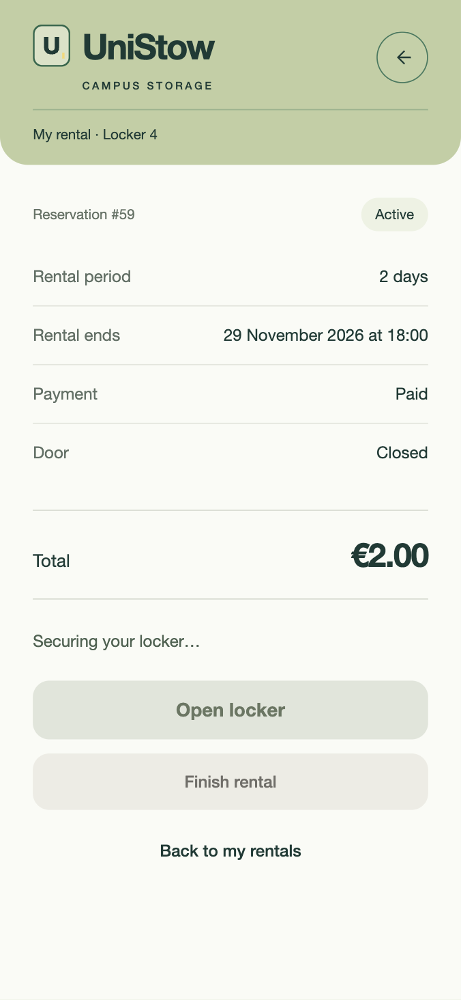 | 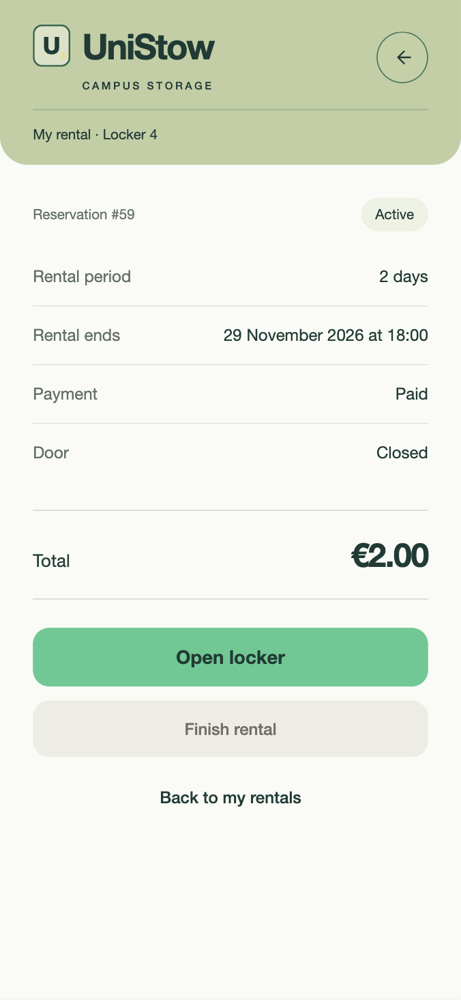 |

### Collection and completion

My rentals listed **Rental #59 · Active** above the existing completed history.
The finishing dialogue explained that collection requires the door to open and
close. The subsequent rental page displayed the collection instruction with
both action buttons disabled. Two identical captures of that waiting state
were supplied; one is retained here.

| Active rental in My rentals | Finishing dialogue |
|-----------------------------|--------------------|
| 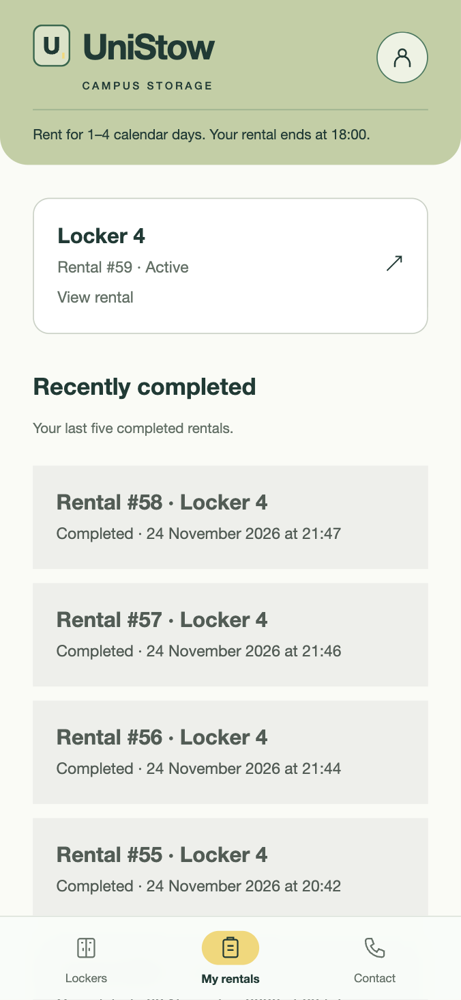 | 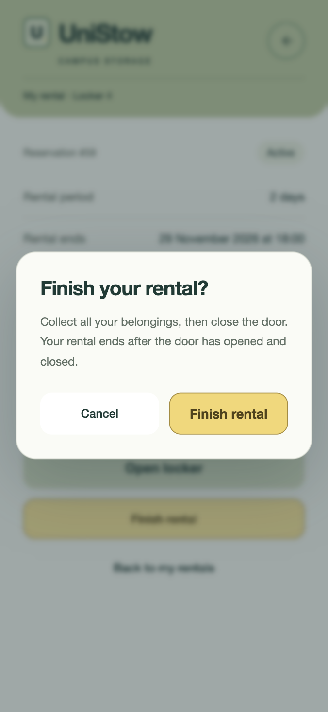 |

| Collection in progress | Completed rental |
|------------------------|------------------|
| 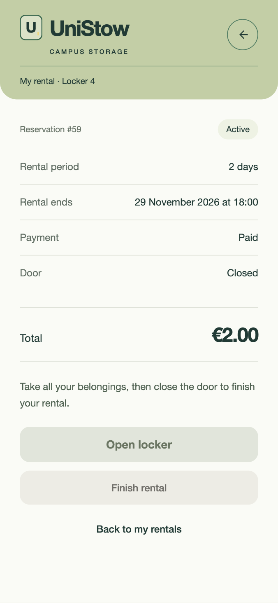 | 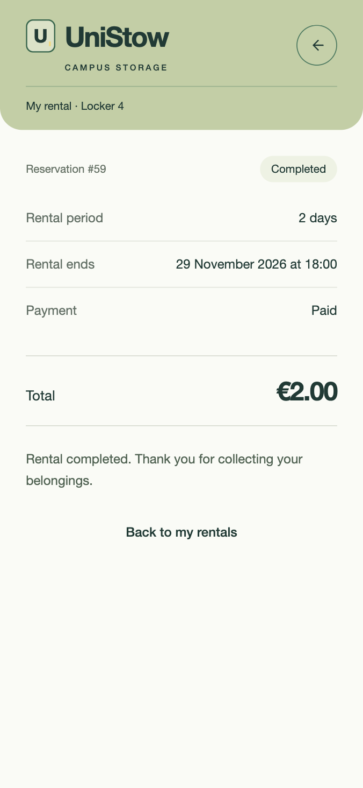 |

The final detail page showed **Completed**, **Paid** and **EUR 2.00**, with
opening and finishing controls removed. My rentals then showed **No current
rentals**, with **Rental #59 · Locker 4** first in the completed history at
**20:05 on 27 November 2026** (Ireland time).

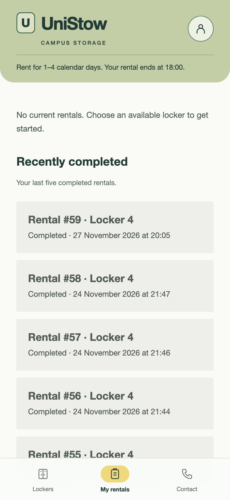

The author identified the final Lockers capture as taken after **Finish rental**.
It showed Locker 4 available again and the count restored to **Available 1**,
completing the displayed journey from availability through rental to release.

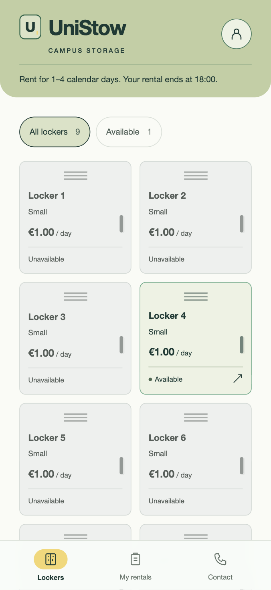

### Database confirmation

A read-only query on the EC2 PostgreSQL container confirmed rental **#59** for
**Locker 4** as `completed`, its payment as `paid`, and its total as **200 cents**.
Payment confirmation was stored at **20:03:51 UTC** and completion at
**20:05:48 UTC** on 27 November 2026, matching the completion minute shown in
My rentals. The query also found a `payment_events` row for the same Checkout
session (`stripe_event_recorded = true`).

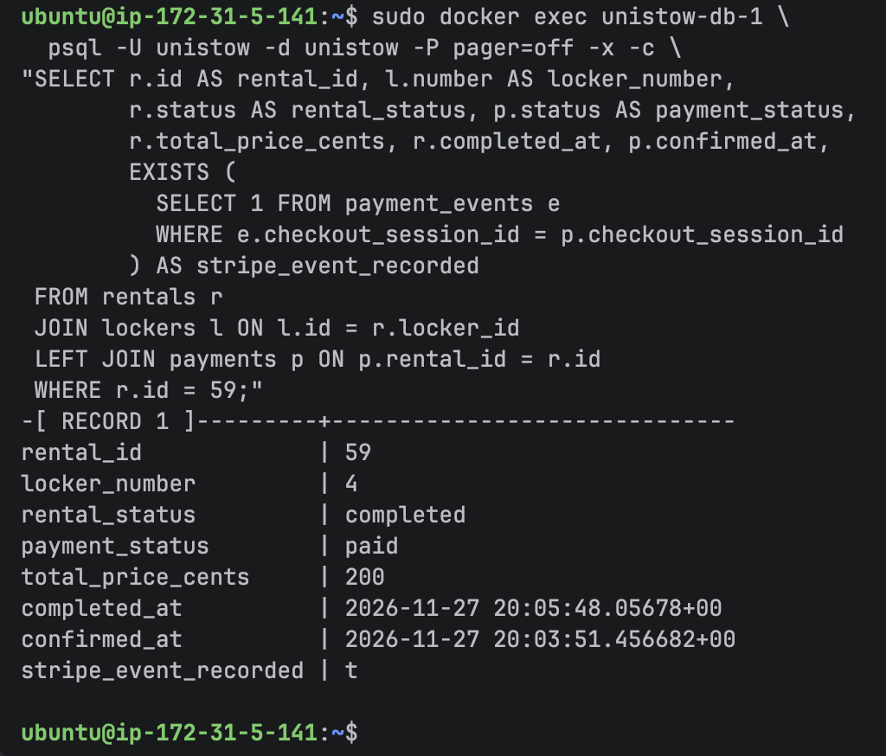

This record combines interface captures, the author's physical opening and
latch check, and the stored database outcome. A continuous demonstration
recording remains to be captured.

## 27 November 2026 — Separate-account balance display (#52)

The author confirmed that these captures use a different account from rental
#59. They show the existing synthetic debt for rental **#52 · Locker 5**,
created for the [22 November test](#separate-test-account--22-november-2026).
This is not a new charge on rental #59.

My rentals displayed **Balance to settle**, **EUR 1.00** unpaid and **No current
rentals**, with a link to rental #52. The detail page showed **Completed** and
**Payment incomplete**, separating the **EUR 1.00** rental cost from **EUR 1.00**
in unpaid extra days. The **EUR 2.00** total includes both; the payment action
requests only the outstanding **EUR 1.00**.

| Separate-account balance notice | Completed rental with an outstanding balance |
|---------------------------------|----------------------------------------------|
| 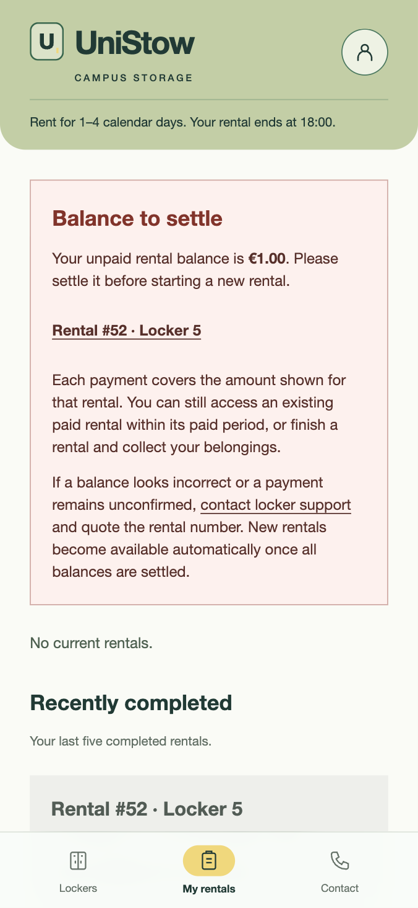 | 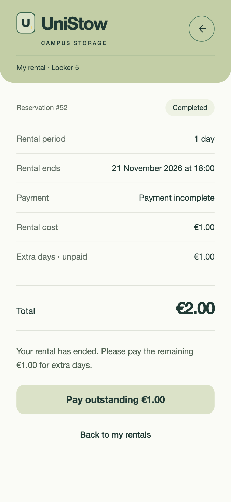 |

The same account's Lockers page showed the balance notice, **Available 0** and
an empty result with the available filter selected. In contrast, the account
used for rental #59 showed Locker 4 available after completion. The displayed
count reflects what that account can book; it does not mean all lockers are
physically occupied.

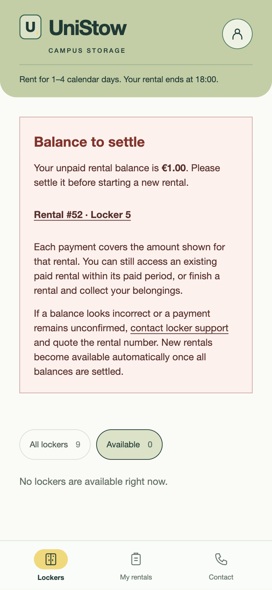

These captures verify the account-specific balance and availability presentation.
They do not show a repayment, a real card decline or a fresh API attempt to book
while the balance remains unpaid.

## 27 November 2026 — Availability between two accounts (#60)

The author tested Locker 4 using two accounts and confirmed that it became
unavailable to the second account both during an unpaid reservation and after
payment. The four supplied captures show the paid phase: rental **#60** was
**Active** and **Paid**, costing **EUR 1.00** for one calendar day ending at
**18:00 on 28 November 2026**.

The owner's Lockers page offered **Continue rental** for Locker 4, and My rentals
listed **Rental #60 · Active**. The other account's Lockers page showed
**Unavailable** for Locker 4, with **Available 0** and no visible balance warning.
The owner's available count was also zero: access to their existing rental
remained available through **Continue rental**.

| Owner's Lockers page | Other account's Lockers page |
|---------------------|------------------------------|
| 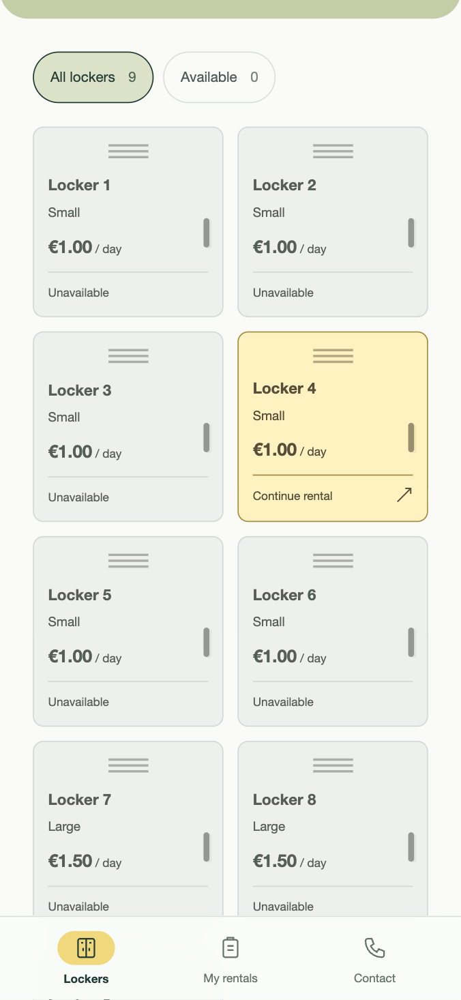 | 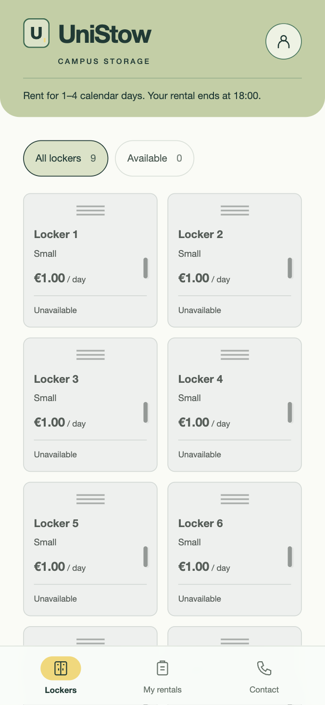 |

| Paid rental details | Owner's My rentals page |
|---------------------|-------------------------|
| 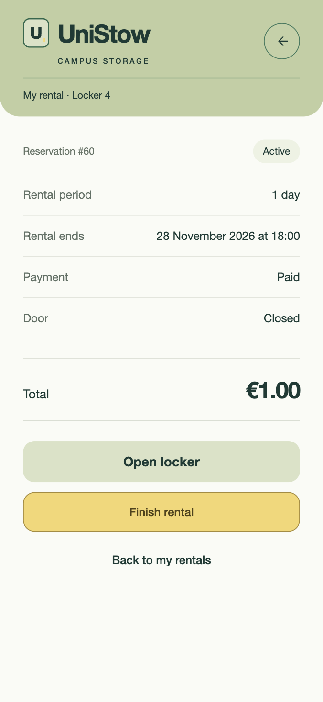 | 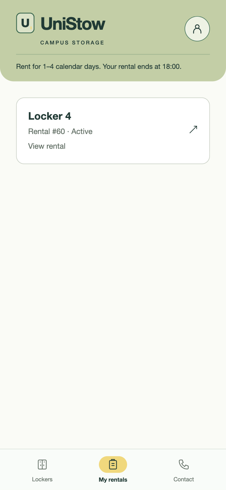 |

The unpaid-reservation result is recorded from the author's manual test report;
no pending-phase capture was supplied for this two-account check.
