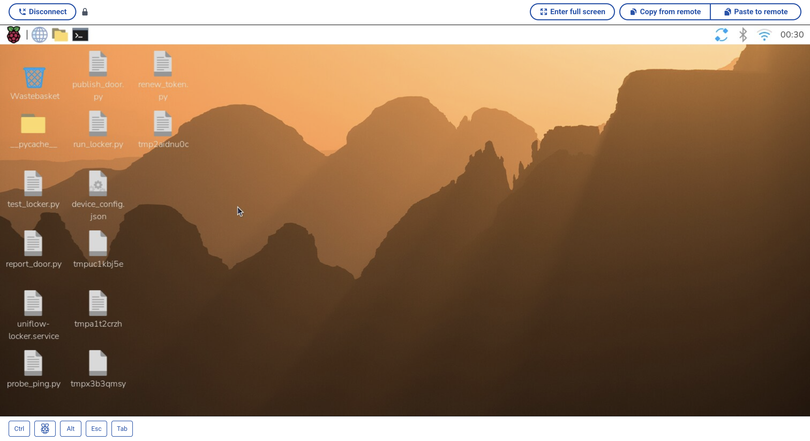
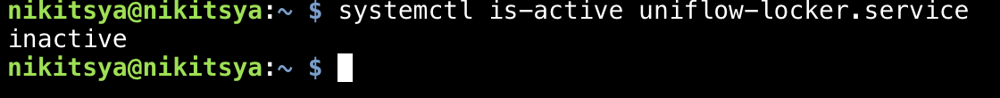
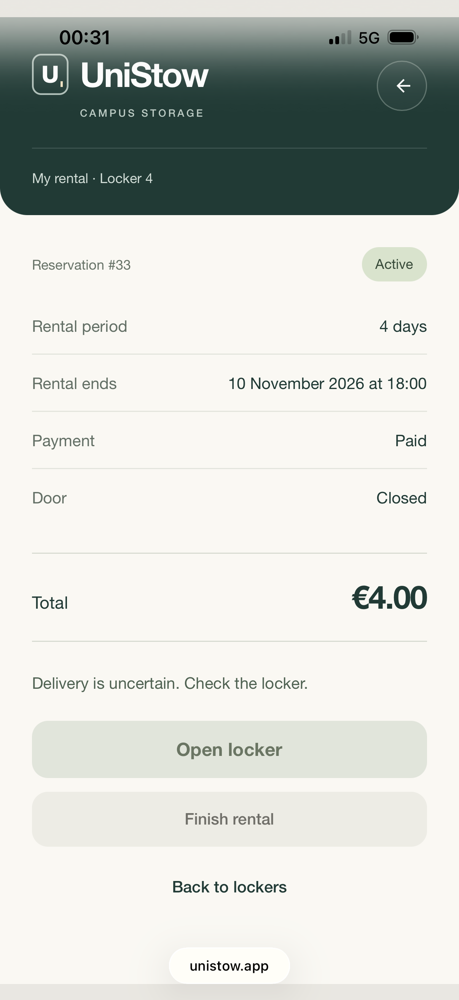
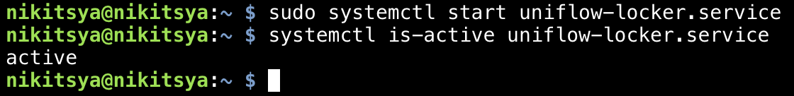
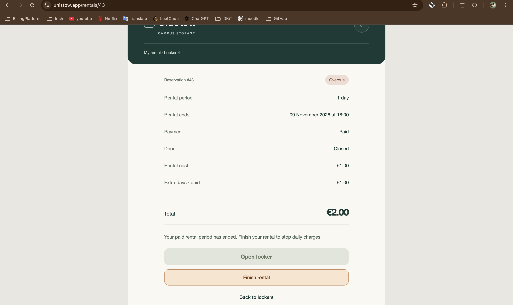

# Usability testing

## 25–26 October 2026 — Local PayBox prototype

These checks took place before the November phone session, when the backend ran on the Mac. Most were developer
walkthroughs. Arthur tested the physical door.

| What we tried                                                       | What the tester saw                                                                                                                                                                                                                                                                  | Outcome or follow-up                                                                                                                                                                                                                                                        |
|---------------------------------------------------------------------|--------------------------------------------------------------------------------------------------------------------------------------------------------------------------------------------------------------------------------------------------------------------------------------|-----------------------------------------------------------------------------------------------------------------------------------------------------------------------------------------------------------------------------------------------------------------------------|
| Create an account, then register the same email again.              | The first request returned 201 and the email. The second returned 409. An invalid request initially gave a server error (500).                                                                                                                                                       | After the fix, invalid input returned 422; the tester confirmed the email error. The registration form also created an account.                                                                                                                                             |
| Sign in, refresh, sign out and refresh again.                       | The email appeared after sign-in and stayed after refreshing. After sign-out it disappeared and stayed gone. A wrong password showed **Incorrect email or password** and left the user signed out.                                                                                   | These observations cover the session. Resuming a reservation after signing back in is a separate check below.                                                                                                                                                               |
| Select Locker 4 while signed out.                                   | After signing in, the renter reached the rental form for the locker they had selected.                                                                                                                                                                                               | The tester confirmed the destination.                                                                                                                                                                                                                                       |
| Reserve Locker 4, return to the list and try to continue.           | Initially the form showed a demo message and nothing appeared in Rentals. After the fix, the tester saw a **Pending** booking and Locker 4 became **Unavailable**. On returning to the list, it was unclear how to continue their own booking.                                       | The owner's card gained **Continue rental**. Check on the final version that leaving the page, or signing out and back into the same account, returns the renter to the same unpaid booking while the hold is valid. A second account should see the locker as unavailable. |
| Leave an unpaid reservation without starting checkout.              | After 15 minutes Locker 4 became available. Reserving again left the old record **Cancelled** and the new one **Pending**.                                                                                                                                                           | The tester checked both records.                                                                                                                                                                                                                                            |
| Pay for a reservation in the Stripe sandbox and return.             | Checkout showed the expected price. After refreshing, the rental showed **Active** and the **Pay** button had disappeared. The sandbox account name on Checkout was confusing.                                                                                                       | The tester confirmed the paid state after refresh. Automatic page updates and clearer Checkout branding were later changes; the chat did not confirm the new branding on a fresh checkout.                                                                                  |
| Open and close the real door while watching its state.              | The magnetic contact reported open and closed as the door moved. The tester later saw the same changes in PayBox and confirmed the latch returned after opening.                                                                                                                     | This checked the sensor and normal movement. It did not cover a door held just short of closure.                                                                                                                                                                            |
| Bring the door slowly towards the frame, then ease it back (Artur). | The magnet triggered before the door was fully seated. The servo moved the latch into the closed position, but the door was still ajar. The sensor then correctly showed **Open**. The projecting latch blocked closure, and the tester reported having to remove and refit the arm. | The local prototype added a stable-closure check and allowed the renter to request another opening to clear the latch. The November version uses automatic retraction. Its slow-closure retest is listed below.                                                             |
| Run the servo test, then reboot the Pi.                             | The arm initially trembled while the programme ran, and one angle setting moved it towards the wall. With pigpio and the tested opening direction, the tester saw a clean movement. A roughly 30 cm lead extension worked.                                                           | After reboot the tester confirmed pigpiod was active and the hardware test still worked.                                                                                                                                                                                    |
| Reopen the local site with the database stopped.                    | The browser showed the service-unavailable page and Pi heartbeats returned 503. The site appeared again once the database was running.                                                                                                                                               | A separate **Internal Server Error** was also reported on a rental page; its cause was not confirmed in that report.                                                                                                                                                        |

The October walkthrough also shaped the interface: keep the rental deadline and price easy to find, show the account
menu from the person icon, keep **My rentals** on its own page, and hide device and door details before payment. The
renter asked for an in-page **Finish rental** dialogue and automatic updates after having to refresh manually. The
November observations below record which of these changes were subsequently checked on a phone.

## 6 November 2026 — UniStow phone session and follow-up checks

A renter used unistow.app on a phone to open Locker 4, close it, collect their belongings and finish the rental. The
physical door opened, held shut after closing and the rental eventually showed **Completed**. The interface review
around that journey focused on three questions: Which locker can I use? What should I do next? How do I back out safely?

This record separates the renter’s observations from design changes and browser checks. The phone journey took place
during development. Later refinements were deployed through commit `7dd8e97`.

### Finding a locker and moving around

| What the renter noticed                                                                                                                                                            | What changed and why                                                                                                                                                                                                                                                           |
|------------------------------------------------------------------------------------------------------------------------------------------------------------------------------------|--------------------------------------------------------------------------------------------------------------------------------------------------------------------------------------------------------------------------------------------------------------------------------|
| On the phone, the available locker showed a blue arrow emoji. The desktop screenshot showed a thin diagonal arrow.                                                                 | Locker and rental links now use a drawn SVG arrow. It takes its colour from the link, so the phone cannot substitute a coloured emoji.                                                                                                                                         |
| In the nine-locker grid, the cards looked tall and narrow. A line below the grid added another visual boundary.                                                                    | Made the cards square and removed the divider. The locker number, size and daily price stay together. A pale green card labelled **Available** stands out among neutral cards labelled **Unavailable**. The words carry the meaning as well as the colours.                    |
| Switching to **My rentals** changed the header, removed the familiar account icon and offered a redundant **Back to lockers** link.                                                | Both list pages now share the branded header and bottom navigation. The renter can switch directly between **Lockers** and **My rentals** in either direction.                                                                                                                 |
| Booking repeated “Locker 4” in several places. Returning to the list made the change in header size and layout especially noticeable. The payment page had the same inconsistency. | Reused the home header throughout the site. Only the short line describing the page changes. Detail pages put a round back button where the account control sits on the list pages. The illustrated locker keeps its **04**, where the number helps identify the physical box. |
| The U looked off-centre in its frame.                                                                                                                                              | Centred the U and reused the same mark in the shared header and browser tab so the site is recognisable throughout the journey.                                                                                                                                                |

### Reserving, paying and changing your mind

- **Before payment.** Someone who changes their mind during the 15-minute reservation can use **Cancel reservation**
  below **Pay**. This releases the locker for someone else without waiting for the reservation to expire.
- **Confirming cancellation.** A styled dialogue asks **Cancel your reservation?** and explains who can use the locker
  afterwards. The white **Keep** button closes the dialogue. The pale orange **Cancel** button confirms cancellation.
  Short labels avoid repeating “reservation” three times. The main payment action stays dark green.
- **After payment.** The message above the buttons has the same breathing room as the pre-payment guidance. **Payment
  confirmed. Your rental is active.** appears once per rental in that browser tab. Opening and closing the door should
  not bring back an old payment announcement.
- **Reading feedback.** Opening, collection and payment updates occupy the message area above the relevant buttons. Each
  new instruction replaces the previous one. This keeps the next step in view instead of making the renter look below
  the controls for a second explanation.

### Opening the door, closing it and finishing

| Situation                                                              | User-facing decision or observed result                                                                                                                                                                                                                                                                     |
|------------------------------------------------------------------------|-------------------------------------------------------------------------------------------------------------------------------------------------------------------------------------------------------------------------------------------------------------------------------------------------------------|
| The renter taps **Open locker**.                                       | Show **Unlocking…**, then **Open the door once it unlocks.** The user needs to know when to pull the door, without having to interpret a command acknowledgement or motor movement.                                                                                                                         |
| The door is already open.                                              | Keep **Open locker** visible but disabled. **Your locker door is open.** explains why, including when the renter returns to the page after walking away.                                                                                                                                                    |
| The renter closes the door.                                            | The page briefly used to flash a “not ready” warning while the latch was moving. Allow time for relocking and show **Securing your locker…** during that transition. In the physical test the page showed **Closed** and the renter checked that the door held shut.                                        |
| A light closure triggers the magnetic sensor, but the door comes ajar. | The renter observed the lowered latch blocking the next attempt to shut the door. The controller was changed to retract the latch if the sensor reports an open door during or after closing, including at startup. A sensor reading and a door that physically holds shut are separate checks.             |
| The renter chooses **Finish rental**.                                  | Use pale orange for the action that ends the rental and ask for confirmation first. The white **Cancel** button dismisses the dialogue. Both this button and **Keep** in the reservation dialogue have no thick brown outline or underline. Keyboard focus uses heavier text.                               |
| The renter confirms and collects their belongings.                     | Keep **Take all your belongings, then close the door to finish your rental.** above the disabled actions throughout collection. It takes precedence over the payment confirmation and ordinary door-open message. The renter confirmed on the phone that opening and closing the door led to **Completed**. |

**Finish rental follow-up on the phone.** The renter confirmed that after confirming **Finish rental** and opening
the door, the button stayed visible and disabled. Tapping it again could not reopen the confirmation dialogue.
A regression test also checked that the button stays disabled when the Pi reports an open door while the database
still shows it as closed.

### Touch, dialogues and interrupted connections

| Test or observation                                              | Result and scope                                                                                                                                                                                                                                                                                                                                                                                                                                                                                 |
|------------------------------------------------------------------|--------------------------------------------------------------------------------------------------------------------------------------------------------------------------------------------------------------------------------------------------------------------------------------------------------------------------------------------------------------------------------------------------------------------------------------------------------------------------------------------------|
| Pull the page past an edge on a phone.                           | The renter wanted the content to stay in place without revealing the background, but still expected a downward pull at the top to refresh. The shared page styles suppress overscroll. A deliberate downward pull of at least 80 CSS pixels refreshes on release. Six scripted gesture cases covered a valid pull, a short pull, sideways and upward movement, a pull starting partway down the page and a two-finger gesture.                                                                   |
| Open a confirmation and interact with the background.            | A Chrome check found that scrolling was locked while a modal was open. A tap inside kept it open. A tap on the backdrop dismissed it and the page retained its scroll position. Dismissing the dialogue does not confirm cancellation or collection. This behaviour is shared across the site.                                                                                                                                                                                                   |
| Open each dialogue and inspect its initially focused button.     | Chrome checks on **Keep** and **Cancel** found no outline, border width or underline. The published stylesheet was compared with the checked version.                                                                                                                                                                                                                                                                                                                                            |
| Leave the site open during a server restart or loss of internet. | The renter saw unsolicited red connection messages while simply viewing a page. Background updates now retry quietly on the locker list, rental list and rental detail. The last loaded content stays visible. Scripted checks exercised a connection failure and an HTTP 503 response. Background payment checks left the existing message alone. Locker controls can be disabled while their state cannot be verified. Feedback still appears if an action the renter actually requests fails. |

### How the physical journey was verified

1. **Read the door.** The Pi published a closed-door reading. The backend logged it and the renter saw **Closed** on the
   active rental page.
2. **Check delivery before moving the latch.** A ping received a matching pong in 0.22 seconds. Test clicks from the
   rental page received acknowledgements in the controller log. These checks established delivery. The separate physical
   test confirmed movement.
3. **Open from the public site.** After the old empty test rental was closed, the renter made a fresh rental, tapped
   **Open locker** on the phone and observed Locker 4 open. After closing it, they checked both the displayed state and
   the physical latch.
4. **Finish from the phone.** The renter tapped **Finish rental**, opened and closed the door and reported
   **Completed**. This checked the outcome beyond the initial button press.
5. **Keep the locker usable after the first hour.** Automatic renewal was enabled for the controller’s one-hour PubNub
   token. The setup reported **Automatic token renewal active on Locker 4**. An opening after the original token expired
   was not recorded.

### 7 November 2026 — Opening Locker 4 while its controller was stopped (#7)

With a paid, active rental, the renter tapped **Open locker**. The phone displayed
“Delivery is uncertain. Check the locker.” A separate check on the Pi showed the controller service was inactive.

| Raspberry Pi desktop (setup)                                      | Controller status                                                                      | Renter’s phone after tapping Open locker                                             |
|-------------------------------------------------------------------|----------------------------------------------------------------------------------------|--------------------------------------------------------------------------------------|
|  |  |  |

**Reconnection test passed.** After the original request expired, the renter restarted the controller on the Pi and
confirmed the service was active. The latch stayed in place until the renter tapped **Open locker** again on the phone.
The renter then saw the latch turn.

### Verification notes and remaining checks

The saved development runs include 58 passing tests for token renewal, 60 for rental notices and 61 in the
payment-confirmation run. These totals are separate runs of overlapping suites. Earlier runs skipped database-dependent
cases, and one physical-command test run recorded 17 errors when the test process could not connect to local PostgreSQL.
The phone observations above come from the real locker, independently of those automated runs.

After the final deployment, the public home page referenced the updated assets and the published dialogue, payment and
live-update scripts and styles matched the local release. The following checks still need a recorded result on the final
version:

- On iPhone Safari, pull down from the top to refresh, then try a short sideways drag. Open each dialogue and try to
  scroll behind it before tapping the backdrop.
- With an unpaid test reservation, choose **Keep** first and confirm that payment is still available. Then choose
  **Cancel** and check that the released locker becomes available to another renter.
- With the locker empty, repeat the light-closure case. Check that the latch retracts when the door comes ajar and that
  the next full closure holds.
- With a valid paid rental, try opening Locker 4 more than an hour after the initial token was issued and record the
  result.

## Service interruptions — 9 November 2026

Issue #16 adds calm status messages above rental actions. A first failed refresh
blocks actions while retrying quietly. Repeated failures show one message.
Locker cards show that availability is being checked until a successful refresh.
An enabled locker with a missing or expired heartbeat is temporarily unavailable,
and the server rejects new reservations for it.

An opening with an unknown outcome tells the renter to check the door before
trying again. This message survives background refreshes until an opening or
collection is confirmed, or the renter explicitly makes another request.
The browser never retries an opening automatically.

Rental page failures offer a retry of the same page and a link to phone support.
Payment and collection status still depend on confirmed server responses.

### Verification

- All 65 backend tests passed with local PostgreSQL enabled, including the
  offline reservation rejection and availability recovery test.
- Automated page tests cover database and unexpected errors, a same-page retry
  and the support link, without exposing the exception text.
- Chrome with a 390 × 844 viewport and simulated network failures passed the
  brief-interruption, repeated-failure and recovery checks.
- The same browser check confirmed that an unknown opening retains its warning
  after refresh and sends exactly one opening request.
- Physical-phone checks with the deployed site and an offline Pi are pending.

Content follows
the [GOV.UK service problem guidance](https://design-system.service.gov.uk/patterns/problem-with-the-service-pages/).

## Extra-day payment summary — 10 November 2026

### Purpose

Make the total understandable by separating the original rental cost from
extra-day charges. A renter should be able to see which charges have been paid
and how they contribute to the total.

### Deployed-site check

Test rental 43 was moved into overdue status by adjusting its dates. One EUR 1
extra-day payment was then collected manually through the billing service in
Stripe test mode. Stripe confirmed `succeeded` with `livemode=false`; no real
money was collected. The automatic billing worker remained disabled.

The supplied desktop-browser screenshot of `unistow.app/rentals/43` shows:

- **Rental cost:** EUR 1.00.
- **Extra days · paid:** EUR 1.00.
- **Total:** EUR 2.00, including both amounts.
- **Payment:** Paid, alongside the separate **Overdue** rental status.
- **Open locker:** disabled after the paid period ended.
- **Finish rental:** available so the renter can collect their belongings.

The message above the buttons explains that the paid rental period has ended
and asks the renter to finish the rental to stop daily charges. Paying an
extra-day charge does not mark the rental as completed.

*Evidence supplied on 10 November 2026: the deployed desktop page after one
successful test-mode extra-day payment.*

This screenshot confirms the paid-charge presentation. It does not verify the
processing or failed-payment presentation, a physical-phone layout, or automatic
execution at the next daily deadline. Those distinctions are covered separately
in the [billing verification notes](database.md#rental-payment-summary).
