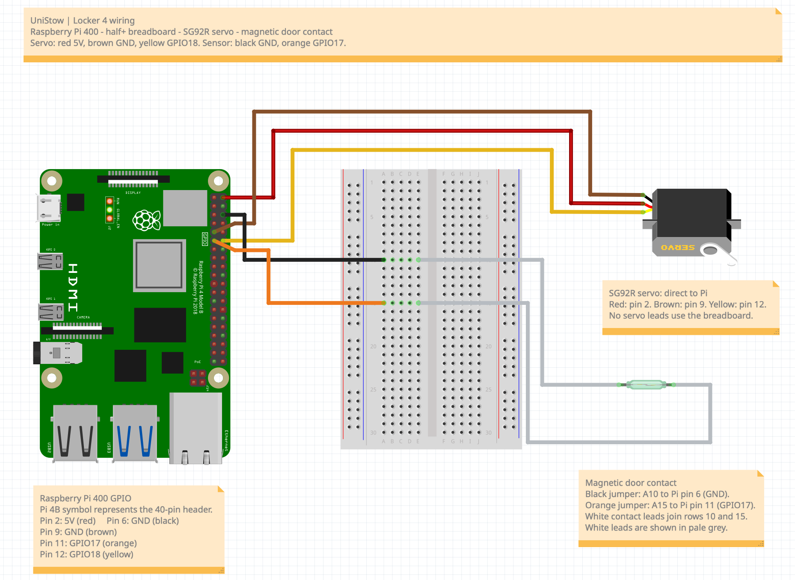
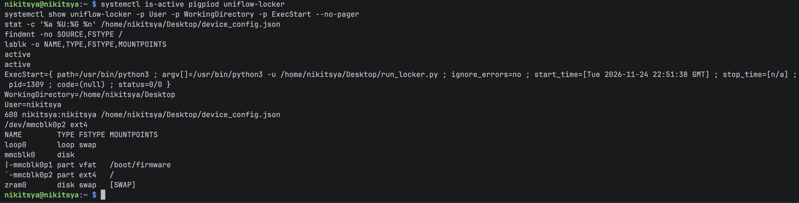

# Raspberry Pi hardware

The door contact connects GPIO17 (physical pin 11) to ground when closed.
The servo receives its control signal on GPIO18 (physical pin 12). Check the
pin numbers on the header when reconnecting the prototype.

## Wiring diagram

Open [unistow-wiring.fzz](unistow-wiring.fzz) in Fritzing and select **Breadboard**.
The diagram uses a half+ breadboard and shows the Locker 4 servo and magnetic
door contact. The PNG export is shown below.



| Connection    | Raspberry Pi header                | Breadboard connection                           | Wire colour |
|---------------|------------------------------------|-------------------------------------------------|-------------|
| Servo supply  | 5V, physical pin 2 in the diagram  | Positive rail to servo VCC                      | Red         |
| Common ground | GND, physical pin 6 in the diagram | Negative rail to servo GND and door contact     | Black       |
| Servo pulse   | GPIO18, physical pin 12            | Row 12, A to E, then servo signal               | Yellow      |
| Door contact  | GPIO17, physical pin 11            | Row 20, A to E, then contact; other lead to GND | Green       |

The author confirmed that the servo is powered from the Raspberry Pi 5V
supply through the breadboard. The drawing uses physical pins 2 and 6 for
power and ground; check these two positions against the actual leads before
using the diagram as an exact wiring record. Breadboard rows and wire
colours are diagram conventions, rather than a record of the physical layout.

The Pi 4B library symbol represents the Pi 400's 40-pin GPIO connections;
it does not represent the Pi 400 case. The servo and reed switch are generic
symbols for the SG92R and the magnetic door contact. The controller enables
the internal pull-up on GPIO17, so the closed contact connects the input to
GND. It reports door position, not proof that the latch is locked.

## Python dependencies

Hardware dependencies are listed separately in `requirements.txt`.

## Connect Locker 4 to Mosquitto

The controller sends door changes and a fresh reading every five seconds to
`unistow/locker-4/events`. It subscribes to `unistow/locker-4/commands`.
Use the device password provisioned in the [broker setup](../deploy/README.md#self-hosted-mqtt).
The HTTPS device key remains separate and authenticates heartbeats, collection
polling and completion acknowledgements.

On the Pi, install Paho in a virtual environment that can import the existing
system GPIO packages. The supplied systemd unit uses this interpreter.

```sh
python3 -m venv --system-site-packages ~/.venvs/unistow
~/.venvs/unistow/bin/python -m pip install 'paho-mqtt>=2.1,<3'
```

Copy `run_locker.py` and `locker_mqtt.py` to the controller directory. For a new
Pi, copy `device_config.example.json` to `device_config.json` and set the HTTPS
device key and MQTT password. On an existing Pi, back up the private file and
retain the HTTPS key and server address when updating the `mqtt` section.
Run `chmod 600 device_config.json` and synchronise
the Pi clock. With a private test CA, set `mqtt.ca_file` to its public
certificate. Production uses the Pi's system trust store for `unistow.app`.

Start with `mqtt.mode` set to `test` on the Pi and select test mode on the
server. On an active paid rental select **Test open delivery**. A matching
acknowledgement confirms the round trip without actuating the test command.
For a physical test, use an empty locker, set Pi mode to `physical`, switch
the server to physical opening and restart both services. Confirm that opening,
sensor updates and collection work together. A lost acknowledgement leaves
delivery uncertain. Check the door before issuing a new request.

## Device credentials and physical access

The controller reads its HTTPS device key and separate MQTT password from
`device_config.json` beside the script. The supplied service expects this file
in `/home/nikitsya/Desktop`. It contains plaintext credentials and should be
owned by the service user, `nikitsya`, with permissions `600`. These permissions
restrict ordinary file access to that user; they do not encrypt the contents or
prevent access by root. The repository ignores `hardware/device_config.json`;
use the blank example when sharing the project. The Pi does not need database
credentials or Stripe secrets.

TLS protects the network connections. The documented
[EBS encryption](../deploy/README.md#storage-encryption) protects the EC2 disk,
not the Pi's SD card. A tamper-resistant enclosure and controls restricting
physical access to the Pi have not been verified.
File permissions alone do not protect credentials if someone removes and reads
the storage, or prevent interference with the wiring.

During demonstrations, keep the Pi, its storage and wiring under the operator's
control. This is an operating precaution, not a verified physical safeguard.

### Device check on 27 November 2026

The author supplied the following output from an authenticated SSH session:

- `pigpiod` and `uniflow-locker` were both `active`.
- The controller ran as `nikitsya`, using `/usr/bin/python3` and the working
  directory `/home/nikitsya/Desktop`.
- `device_config.json` had permissions `600` and owner/group
  `nikitsya:nikitsya`, matching the credential file restrictions above.
- The root filesystem was mounted directly from `/dev/mmcblk0p2` as `ext4`.
  The block-device listing showed no LUKS/dm-crypt layer protecting that root
  partition. File-level encryption was not checked.



This verifies service status and file permissions, not a complete physical
opening/collection cycle or the controller's current MQTT and HTTPS connections.

## Optional local sensor test

This first connection step reports the sensor only; it does not unlock the locker.
These instructions assume the current database schema and locker records are installed;
see [database setup](../docs/database.md#initial-setup).

1. Connect the Mac and Pi to the same trusted local network. Stop the existing backend,
   then run from `backend` on the Mac:

   ```bash
   uv run uvicorn main:app --host 0.0.0.0 --port 8000
   ```

2. Find the Mac's local IP in System Settings > Wi-Fi > Details > TCP/IP.
   On the Pi, open `http://MAC_LOCAL_IP:8000` to check connectivity.
   `localhost` on the Pi refers to the Pi, not the Mac. `APP_BASE_URL` is the
   browser checkout return address; it is separate from the Pi server address.
3. Copy `report_door.py` and `device_config.example.json` to the same folder on the Pi.
   Rename the JSON file to `device_config.json`. Set `server_url` to the Mac's address
   and `device_key` to `UNISTOW_DEVICE_KEY` from the Mac project's `.env`.
   Copy only that key, not database or Stripe secrets. Do not commit the JSON file.
4. Stop other GPIO tests, then run `report_door.py` in Thonny. Expect
   `Connected to UniStow. Door: closed.` Open and close the door; the paid rental page updates its door state
   automatically.

Reports arrive every two seconds. After 15 seconds without a report, the device is
treated as offline, the door reads `Unknown` and opening is unavailable.
HTTP is for this trusted local prototype only; use HTTPS on untrusted networks.
Do not forward port 8000 on the router or expose pigpiod to the network.
Stop the reporting script before running the locker test.

## Open a paid locker

With the controller service running and the door closed, sign in to UniStow as
the owner of an active, paid Locker 4 rental and press **Open locker**. Open
the door after the latch retracts, then close it. After one second continuously
closed, the controller commands the latch closed.

The controller uses the tested 1500 us closed and 2250 us open pulses.
After closing, it checks the door for another two seconds before acknowledging collection.
An open sensor reading retracts the latch at startup, during a closing attempt,
or after the latch has settled. The controller waits for a full second of
continuous closed readings before lowering it again. After three failed retries
it leaves the latch retracted for assistance. Mount the sensor so it reports
closed only when the door is seated and the latch can clear the frame. **Finish rental** requires
a closed door and a ready controller. Local closing continues if the network connection drops.
Opening requests expire after 10 seconds and are dispatched only once. Wait for the button to become available
before requesting another opening.
Opening is limited to the paid rental period. An overdue renter can still request collection.
For automatic controller startup, follow the section below.

## Start pigpiod automatically

The service expects pigpiod at `/usr/local/bin/pigpiod` and its library installed.
Copy `pigpiod.service` from this folder to the Raspberry Pi Desktop, then run:

```bash
sudo install -m 644 ~/Desktop/pigpiod.service /etc/systemd/system/pigpiod.service
sudo systemctl daemon-reload
sudo systemctl enable pigpiod
```

Stop the Thonny test and save your work, then reboot:

```bash
sudo reboot
```

Enabling without starting avoids conflicting with the manually started daemon.
After reboot, check:

```bash
systemctl is-active pigpiod
python3 -c "import pigpio; pi = pigpio.pi('localhost'); print('Connected:', pi.connected); pi.stop()"
```

Expected: `active` and `Connected: True`. If it fails:

```bash
journalctl -u pigpiod -b --no-pager -n 30
```

This service starts pigpiod only. The controller has its own service below.
The service accepts local socket connections only and disables the FIFO interface.
See the [pigpiod options](https://github.com/joan2937/pigpio/blob/master/pigpiod.1).

## Finish a rental

Choose **Finish rental** in My rental and confirm that you will collect everything.
Open the door, remove your belongings and close it. The Pi commands the latch closed
and checks the door for another two seconds before sending a completion acknowledgement.
The rental status updates automatically to `completed`; Locker 4 becomes available. **Open locker** alone does not
finish the rental.

If the network drops, keep the script running: it retries the acknowledgement.
If the script or Pi stops before acknowledgement, the rental stays occupied and
needs checking by the operator. Use the Contact page if the controller is unavailable.

## Start the controller automatically

This service uses the Pi user `nikitsya` and expects `run_locker.py`,
`locker_mqtt.py` and `device_config.json` in `/home/nikitsya/Desktop`.
Stop all GPIO scripts in Thonny and close the door before starting the service.
Copy `uniflow-locker.service` to the Pi Desktop. The commands below disable earlier
controller services before starting this one. Keep the existing device key in
`device_config.json` and run only one controller at a time.

```bash
sudo install -m 644 ~/Desktop/uniflow-locker.service /etc/systemd/system/uniflow-locker.service
sudo systemctl daemon-reload
# Stop earlier controller services before starting this one.
for unit in paybox-locker.service unistow-locker.service; do
    if systemctl cat "$unit" >/dev/null 2>&1; then
        sudo systemctl disable --now "$unit" || exit 1
    fi
done
sudo systemctl enable uniflow-locker.service
sudo systemctl restart uniflow-locker.service
systemctl is-active uniflow-locker.service
```

Expected: `active`. Check messages with:

```bash
journalctl -u uniflow-locker.service -b --no-pager -n 20
```

The supplied unit runs `/home/nikitsya/.venvs/unistow/bin/python`; install the
virtual environment described above before enabling it. The
[27 November check](#device-check-on-27-november-2026) confirmed that the running
unit still uses `/usr/bin/python3`, as it did on 10 November. Update the unit
when adopting the supplied virtual-environment version.
To check after a power cycle, run
`systemctl is-active pigpiod uniflow-locker` on the Pi and open the rental
page to check that the displayed door state follows the sensor.

Production uses the backend and database on EC2. For the local prototype,
keep the Mac backend and PostgreSQL running while testing.

Do not run a second controller or GPIO test in Thonny while the service is active.
Before a manual test, use `sudo systemctl stop uniflow-locker.service`.
After stopping the test, use `sudo systemctl start uniflow-locker.service`.
After updating the script, use `sudo systemctl restart uniflow-locker.service`.
To remove automatic startup, use `sudo systemctl disable --now uniflow-locker.service`.
